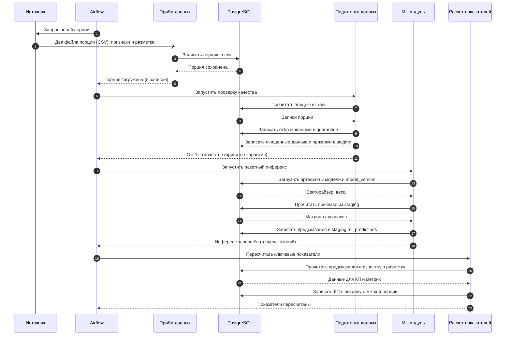
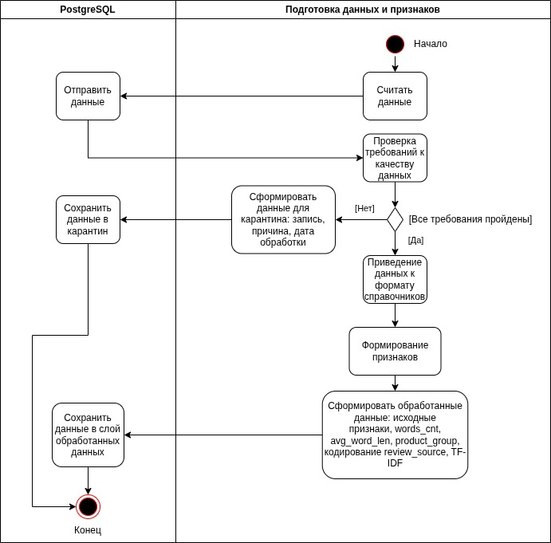
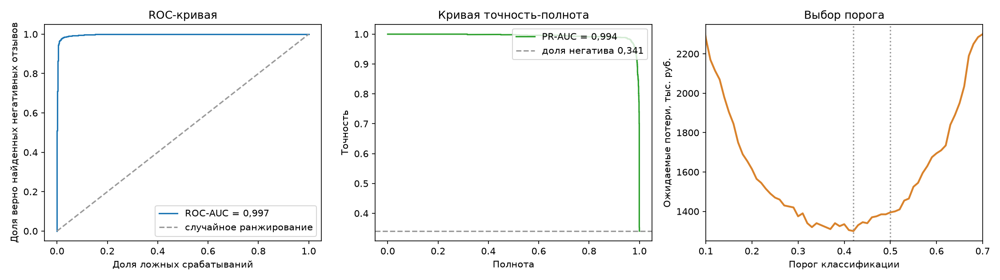
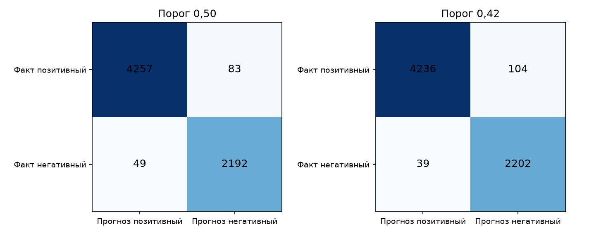
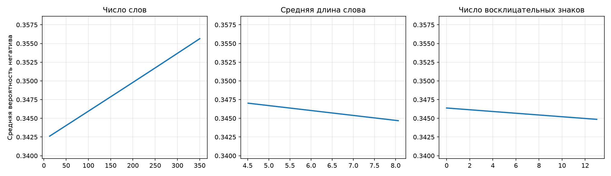
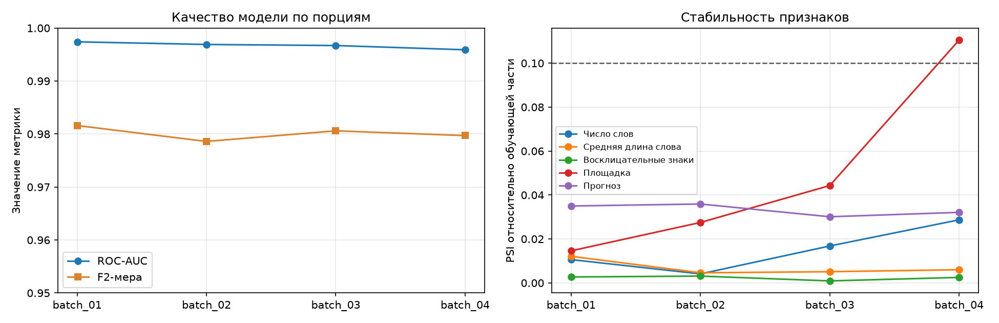

# 1 Архитектурно-аналитический блок 

## 1.1 Проектирование жизненного цикла ML-модели

| этап жизненного цикла модели | описание                                                                                                                                                                                                                                                                                                                                                                                                                                                                   |
| ---------------------------- | -------------------------------------------------------------------------------------------------------------------------------------------------------------------------------------------------------------------------------------------------------------------------------------------------------------------------------------------------------------------------------------------------------------------------------------------------------------------------- |
| Бизнес-метрика               | Оптимизируется удержание клиентов — снижение ожидаемых потерь выручки от оттока. Классификатор по отзыву определяет эмоциональный окрас отзыва, что позволяет определить долю клиентов, которые имеют повышенный шанс уйти из банка. Трансляция в метрики машинного обучения: ROC-AUC как основная метрика выбора модели, PR-AUC и F2-мера как вспомогательные, Brier Score для калибровки вероятностей после выбора рабочего порога. |
| Источники и поставка данных  | Отзывы клиентов из внешних источников (Banki.ru, Sravni.ru, ВКонтакте, Одноклассники и др.) от действующих клиентов Т-Банка о качестве продуктов, услуг и клиентского сервиса. Обновление происходит по мере появления новых публикаций. На инференсе модель получает только текст и контекст; оценка эмоции используется исключительно как разметка при обучении, а применяется модель к потоку, где разметка появляется с задержкой.                                     |
| Обучение и валидация         | Используется временное разбиение. Исходная часть делится по датам в пропорции 80 на 20. Гиперпараметры подбираются кросс-валидацией на пять блоков внутри обучающей части: проверочный блок получает около 16,7 процента обучающей части, а обучение каждый раз выполняется на всех более ранних записях. Артефакты векторайзер и веса сохраняются локально.                                                                                                             |
| Эксплуатация                 | Предсказания заказчку поставляются в виде пакетного расчёта. Оркестратор ежедневно забирает новые порции данных, отправляет в модели и складывает предсказания (вероятность оттока, ожидаемый балл для каждого отзыва) в витрину данных DWH. Затем на основе данных из витрины данных формируются дашборты, где бизнес видит агрегированные KPI и списки клиентов для проработки.                                                                                          |
| Мониторинг                   | Дрейф данных вызывают такие внешние факторы, как изменение распределения длины отзывов, появление нового сленга/продуктов, сдвиг в пропорциях источников (например, резкое увеличение отзывов из ВК), изменение старых продуктов. Для решения проблемы дрейфа данных будет запускаться цикл переобучения. Условия запуска: по расписанию (раз в месяц) и по событию (падение метрик моделей ниже порога (после появления истинной разметки)).                              |
## 1.2 Выбор и анализ архитектурных подходов

Разрабатываемая система решает задачу бинарной классификация. На этапе инференса модель получает только текст отзыва и мета-данные. Результатом работы системы являются эмоциональная окраска нового отзыва, которые агрегируются в витрине данных и визуализируются в BI-дашбордах для бизнес-аналитиков и специалистов поддержки.

Поток данных начинается с внешних источников отзывов, откуда новые порции данных загружаются в сырой слой PostgreSQL. Далее Python-пайплайн, оркестрируемый через Airflow, выполняет очистку данных и переносит записи в слой `staging`, где хранятся обработанные отзывы и извлечённые признаки. На этом же слое формируется материализованная таблица, объединяющая очищенные отзывы с истинной разметкой для обучения моделей. Обученные модели применяются к новым порциям данных в режиме инференса, а предсказания вместе с версией модели записываются в слой обработанных данных (`staging`). Витрина данных строится на таблицах слоя обработанных данных. BI-система Redash подключается к витрине по SQL и строит дашборды с ключевыми показателями: долей клиентов в зоне риска, ожидаемыми потерями выручки, распределением прогнозируемых оценок. По мере поступления истинной разметки (с задержкой в несколько дней или недель) слой обработанных данных обогащается фактическими значениями, что позволяет рассчитывать метрики качества модели и принимать решение о переобучении по расписанию или при деградации метрик.

Представление структуры проекта в виде схемы:

## 1.3 Обзор и обоснование MLOps-инструментов

| Инструмент                    | Функция                                                                           | Обоснованеие                                                                                                                                                                                                                                                                                                   |
| ----------------------------- | --------------------------------------------------------------------------------- | -------------------------------------------------------------------------------------------------------------------------------------------------------------------------------------------------------------------------------------------------------------------------------------------------------------- |
| Python (pandas, scikit-learn) | Ядро вычислений: очистка данных, генерация признаков, обучение и инференс моделей | Простота в написании и сопровождении кода. Широкий набор инструментов.                                                                                                                                                                                                                                         |
| Airflow                       | Оркестрация пайплайна                                                             | Задачи пайплайна зависимы по порядку. Airflow описывает эти зависимости, автоматически следит за порядком, повторяет упавшие шаги и ведёт журнал запусков. Без Airflow пришлось бы писать самодельный планировщик.                                                                                                |
| PostgreSQL                    | Хранение данных                                                                   | Одна СУБД закрывает и сырые данные, и витрину для BI — не нужно поддерживать несколько систем. SQL-агрегации выполняются внутри БД, а не в Python, что ускоряет обработку. Поддерживает схемы, транзакции и одновременный доступ из Python-пайплайна и Redash. Открытая лицензия — нулевая стоимость владения. |
| DBeaver                       | Клиент СУБД: развёртывание БД, ER-диаграмма, SQL-запросы                          | Визуально проверяет физическую схему без написания кода. Универсален: работает и с SQLite, и с PostgreSQL, поэтому не создаёт привязки к конкретной СУБД.                                                                                                                                                      |
| Redash                        | BI-система                                                                        | GUI для удобного просмотра полученных результатов от модели и аналитических запросов. Ключевой плюс: работает напрямую через SQL к PostgreSQL — не нужен отдельный слой загрузки данных в BI.                                                                                                                  |
| Docker                        | Контейниризация                                                                   | Для воспроизводимости системы и управляемости.                                                                                                                                                                                                                                                                 |
| Git                           | Система контроля версий                                                           | Версионирование кода и данных.                                                                                                                                                                                                                                                                                 |

| Функция                | Выбрано          | Альтернатива                        | Почему отклонена                                                                                                                                                                       |
| ---------------------- | ---------------- | ----------------------------------- | -------------------------------------------------------------------------------------------------------------------------------------------------------------------------------------- |
| Оркестрация            | **Airflow**      | cron, Prefect, Dagster              | cron не описывает зависимости между шагами и не даёт журнала запусков; Prefect/Dagster — современнее, но Airflow — стандарт индустрии.                                                 |
| Хранилище              | **PostgreSQL**   | SQLite, MySQL                       | SQLite не выдерживает одновременный доступ из Redash и пайплайна (блокировки на запись); MySQL не даёт преимуществ перед PostgreSQL при меньшем наборе возможностей (нет удобных схем) |
| Клиент СУБД            | **DBeaver**      | psql, pgAdmin                       | psql — только терминал, не строит ER-диаграмму; pgAdmin привязан к PostgreSQL и менее удобен для импорта CSV                                                                           |
| BI                     | **Redash**       | Yandex DataLens, Power BI, Superset | DataLens и Power BI требуют облака/аккаунта и ломают принцип локального запуска; Superset тяжелее в настройке при том же результате для одного дашборда                                |
| Контейнеризация        | **Docker**       | venv, Conda                         | venv/Conda изолируют только Python, но не PostgreSQL и Airflow — воспроизводимость системы целиком не достигается                                                                      |
| Версионирование данных | **Git**          | DVC, Git LFS                        | Датасет 30 МБ — DVC требует внешнего хранилища и усложняет развёртывание; LFS избыточен на таком объёме.                                                                               |
| ML-фреймворк           | **scikit-learn** | PyTorch, CatBoost                   | Задача — TF-IDF + логистическая регрессия и порядковая регрессия; глубокие сети здесь избыточны и требуют GPU                                                                          |

Выбранный стек снижает стоимость сопровождения и гарантирует воспроизводимость за счёт устранения избыточных слоёв и фиксации версий всех компонентов. Единая СУБД PostgreSQL хранит данные всех трёх уровней (raw/staging/marts) в одной системе с разделением через схемы, что исключает синхронизацию между хранилищами и риск рассогласованности. Airflow централизует управление зависимостями между шагами пайплайна: отказ этапа фиксируется в журнале и перезапускается автоматически, а сам DAG описывается в Python и версионируется через Git, что исключает расхождение логики между окружениями. BI-система Redash работает напрямую через SQL к витрине, устраняя дополнительный слой выгрузки. Все компоненты имеют открытые лицензии и упакованы в Docker-контейнеры: docker-compose поднимает PostgreSQL, Airflow и Redash в фиксированных версиях на любой машине, исключая ошибки. Git версионирует и код, и данные, что позволяет воспроизвести любой эксперимент. SQL-скрипты в папке `sql/` воспроизводят структуру базы данных из кода, а не через ручное создание в GUI, гарантируя идентичность физической модели на любом окружении.

# 2 Данные и разведочный анализ

## 2.1 Данные и сценарий обновления

Одна порция данных является выгрузкой данных за произвольный период времени. Целевая переменная неизвестна в момент поступления порции.

## 2.2 Предметный разведочный анализ данных

- ноутбук EDA

## 2.3 Требования к качеству данных и ключевые показатели

| №   | Признак(и)       | Требование                                                        | Действие при нарушении                                        |
| --- | ---------------- | ----------------------------------------------------------------- | ------------------------------------------------------------- |
| 1   | `review_text`    | Не пустой и не короче 20 символов                                 | Карантин                                                      |
| 2   | `review_text`    | В системе нет отзыва с таким же текстом                           | Карантин                                                      |
| 3   | `review_dttm`    | Парсится как дата, не в будущем, не старше 3 лет от даты порции   | Карантин                                                      |
| 4   | `product`        | Значение из фиксированного справочника, без регистровых вариантов | Приведение к справочнику; значение вне справочника — карантин |
| 5   | `review_source`  | Значение из справочника площадок                                  | Карантин                                                      |
| 6   | `review_emotion` | Значение из двух допустимых: позитивный или негативный            | Карантин                                                      |

**Карантин** — отдельная таблица (схема `quarantine`), куда попадает каждая исключённая запись целиком вместе с причиной отклонения и датой порции. Ничего не удаляется: разбор выполняет человек, после чего запись либо правится и возвращается в поток, либо закрывается.

| Показатель | Как рассчитывается | Использует модель | Какое решение помогает принять |
|---|---|---|---|
| Доля негативных отзывов | Отзывов с `p(негатив) ≥ 0.5` / отзывов с текстом за порцию | Да | Масштаб претензионного потока, план загрузки поддержки |
| Топ продуктов по прогнозному негативу | Доля `p ≥ 0.5` в разрезе `product`, продукты с n ≥ 30 | Да | Куда направить продуктовую команду |
| Дельта доли негатива к предыдущей порции | `share_t − share_(t−1)`, п.п. | Да | Триггер разбора инцидента и внепланового переобучения |
| Доля карантина | Записей в карантине / записей порции | Нет | Качество входных данных, разбор с поставщиком |
| Доля известной разметки | Записей с заполненной `review_emotion` / всего записей | Нет | Задержка разметки, готовность к переобучению |

## 2.4 Требования к системе

| ID   | Требование                                                                                                                                                 | Группа           | Способ проверки                                             |
| ---- | ---------------------------------------------------------------------------------------------------------------------------------------------------------- | ---------------- | ----------------------------------------------------------- |
| F-01 | Система сохраняет поступившую порцию в слой "raw" с меткой порции, не перезаписывая ранее загруженные данные                                               | Функциональное   | Загрузить две порции, проверить наличие обеих в слое "raw"  |
| F-02 | Система проверяет каждую запись порции по требованиям качества и переносит нарушившие в карантин с указанием причины                                       | Функциональное   | Демонстрация на порции с известными нарушениями             |
| F-03 | Система нормализует справочники, удаляет дубликаты.                                               | Функциональное   | Сверка числа записей до и после обработки                   |
| F-04 | Система обучает модель на данных с разметкой и сохраняет артефакты и метрики с версией модели.                                                             | Функциональное   | Проверка сохранённых артефактов                             |
| F-05 | Система добавляет поступившую истинную разметку к ранее обработанным записям в слое обработанных данных (`staging`)                                                            | Функциональное   | Число записей с разметкой выросло на размер порции разметки |
| F-06 | Система присваивает каждой записи из обработанного слоя данных вероятность негатива, версию модели и сохраняет результат в слой обработанных данных (`staging`)                  | Функциональное   | Демонстрация записей в витрине данных                       |
| F-07 | Переобучение не изменяет ранее записанные предсказания                                                                                                     | Функциональное   | Запрос данных по двум версиям модели                        |
| F-08 | После инференса система пересчитывает ключевые показатели и записывает значения в витрину с меткой порции                                                             | Функциональное   | Демонстрация витрины                                        |
| F-09 | Панель отображает текущее значение и динамику ключевых показателей по порциям                                                                              | Функциональное   | Демонстрация                                                |
| N-01 | После завершения ETL показатели на панели обновлены не позднее чем через 15 минут                                                                          | Нефункциональное | Замер времени                                               |
| N-02 | Падение шага пайплайна не теряет порцию: перезапуск продолжает с последнего успешного шага, порция гарантированно обрабатывается не более чем за 2 попытки | Нефункциональное | Искусственное падение пайплайна, проверка восстановления    |
| D-01 | `review_text` не пустой и не короче 20 символов                                                                                                            | Качество данных | Демонстрация на порции с известными нарушениями             |
| D-02 | В системе нет отзыва с таким же `review_text`                                                                                                              | Качество данных | Демонстрация на порции с известными нарушениями             |
| D-03 | `review_dttm` парсится как дата, не в будущем, не старше 3 лет от даты порции                                                                              | Качество данных | Демонстрация на порции с известными нарушениями             |
| D-04 | Значение `product` из фиксированного справочника, без регистровых вариантов                                                                                | Качество данных | Демонстрация на порции с известными нарушениями             |
| D-05 | Значение `review_source` из справочника площадок                                                                                                           | Качество данных | Демонстрация на порции с известными нарушениями             |

## 2.5. Архитектура системы

### 2.5.1 Логическая архитектура

| Компонент системы             | Назначение                                                               | Входы                                                                   | Выходы                                                                     | Реализация |
| ----------------------------- | ------------------------------------------------------------------------ | ----------------------------------------------------------------------- | -------------------------------------------------------------------------- | ---------- |
| Приём данных                  | Загрузка данных из источника в хранилище                                 | Выгрузка порции от источника                                            | Порция в слое сырых данных с меткой порции                                 | ПР-3       |
| Хранилище                     | Хранение сырых, обработанных данных и предсказаний модели                | Сырые данные, обработанные данные, предсказания, разметка               | Обработанные данные, таблица признаков для обучения, витрина для аналитики | ПР-3       |
| Подготовка данных и признаков | Проверка качества, очистка, нормализация справочников, таблица признаков | Порция из слоя сырых данных                                             | Записи в слой обработанных данных или  в карантин                          | ПР-3       |
| ML-модуль                     | Обучение модели и пакетный инференс                                      | Признаки с разметкой — обучение; без разметки — инференс                | Артефакты модели с версией; предсказания                                   | ПР-3       |
| Расчёт показателей            | Пересчёт ключевых показателей системы и метрик качества модели           | Предсказания из слоя обработанных данных (`staging`), истинная разметка | Ключевые показатели в витрине с меткой порции; метрики по версиям модели   | ПР-3       |
| Панель                        | Отображение показателей пользователю                                     | Витрина показателей                                                     | Дашборд: значения и динамика по порциям                                    | ПР-4       |
| Оркестратор                   | Запуск этапов системы в нужном порядке                                   | Расписание и граф зависимостей (DAG)                                    | Запущенные задачи, журнал запусков                                         | ПР-3       |

### 2.5.2 Диаграммы

Диаграмма С4 уровня контекста

Диаграмма С4 уровня контейнеров

Диаграмма вариантов использования UML

Диагрмма последовательности UML для основного сценария обработки новой порции данных

Новая порция попадает в слой сырых данных, после чего те же шаги обработки, что и при обучении, переносят порцию в слой обработанных данных и обогащают предсказаниями модели, а витрина данных строится на таблицах слоя обработанных данных. Пересчёт ключевых показателей выполняется сразу после инференса или после получения разметки и пишется в витрину с меткой порции, поэтому каждый запуск добавляет новую точку динамики, не изменяя предыдущие. Redash читает витрину напрямую по SQL, так что панель обновляется вместе с данными без отдельного слоя загрузки.

## 2.6. Пайплайн обработки данных и план признаков

Диаграммы деятельности UML

| Шаг пайплайна                                                        | Вход                                                   | Действие                                                                                                                                                                           | Выход                                                                 |
| -------------------------------------------------------------------- | ------------------------------------------------------ | ---------------------------------------------------------------------------------------------------------------------------------------------------------------------------------- | --------------------------------------------------------------------- |
| Считать данные                                                       | Два файла порции (CSV): файл признаков и файл разметки | Чтение файлов, приведение колонок к типам, проставление метки порции                                                                                                               | Таблицы исходных данных в слое сырых данных (raw) и метка порции      |
| Проверка требований к качеству данных                                | Таблицы исходных данных порции                         | Проверка записей признаков по требованиям 1–3 и 5 табл. 2.3, записей разметки по требованиям 4 и 6                                                                                 | Отчёт о проверке: принятые записи и отбракованные с указанием причины |
| Сформировать данные для карантина: запись, причина, дата обработки   | Отбракованные записи и причина отклонения              | Формирование строки карантина: запись целиком, причина отклонения, дата порции                                                                                                     | Набор записей для таблицы `quarantine`                                |
| Приведение данных к формату справочников                             | Принятые записи                                        | Нормализация `product` и `review_source` по справочникам: регистр, пробелы, канонические значения                                                                                  | Принятые записи с каноническими значениями справочников               |
| Формирование признаков                                               | Принятые записи после нормализации                     | Расчёт `words_cnt`, `avg_word_len` и `exclaim_cnt`, one-hot кодирование `review_source` и TF-IDF по `review_text` выполняются внутри конвейера модели при обучении и при инференсе | Матрица признаков                                                     |
| Сформировать обработанные данные из исходных полей записи и разметки | Очищенные отзывы и очищенная разметка                  | Соединение отзывов и разметки по ключу `id_client` и `review_dttm` в одну строку                                                                                                   | Таблица подготовленных данных                                         |
| Сохранить данные в слой обработанных данных                          | Таблица подготовленных данных                          | Запись в `staging` по ключу `id_client` + `review_dttm`                                                                                                                            | Записи в `staging`, готовые к обучению модели                         |
| Сохранить данные в карантин                                          | Набор записей карантина                                | Запись в `quarantine`: запись целиком, причина, дата порции                                                                                                                        | Записи в `quarantine`, доступные для разбора человеком                |

Шаги от чтения порции до записи в `staging` и `quarantine` одинаковы для обучения и для обработки новой порции: считывание файлов, проверка требований 1–3 и 5 для записей признаков, 4 и 6 для записей разметки, формирование записи карантина, приведение категориальных признаков к справочникам, расчёт признаков, сборка строки подготовленных данных и запись в хранилище выполняются одним и тем же кодом. При обучении к этому добавляются операции, которых нет в потоке новой порции: временное разбиение на обучающее и валидационное окно, подбор гиперпараметров по кросс-валидации внутри тренировочного окна, собственно обучение и сохранение артефактов вместе с метриками и версией модели.

Пайплайн воспроизводим за счёт того, что параметры модели сохраняются как артефакт с версией - в любой момент можно вернуться к определённой версии. Запуск выполняется одной командой через оркестратор, где граф зависимостей, код и DDL-скрипты лежат в Git, а окружение зафиксировано версиями в Docker-образах, поэтому на любой машине поднимается одинаковый стек.

| Признак         | Исходные данные | Преобразование                                                                                                                                  | Гипотеза                                                                                                                                                                         |
| --------------- | --------------- | ----------------------------------------------------------------------------------------------------------------------------------------------- | -------------------------------------------------------------------------------------------------------------------------------------------------------------------------------- |
| `words_cnt`     | `review_text`   | Разбиение текста по пробелам и подсчёт числа слов.                                                                                              | Негативные отзывы длиннее позитивных. Число слов — прямая производная длины текста, устойчивая к длине отдельного слова.                                                         |
| `avg_word_len`  | `review_text`   | Сумма длин слов, делённая на число слов.                                                                                                        | Средняя длина слова — производный признак от длины отзыва, выделенный по результатам проверки гипотезы 1 как дополнительная характеристика текста.                               |
| `exclaim_cnt`   | `review_text`   | Подсчёт восклицательных знаков в тексте. | Восклицательные знаки передают интенсивность высказывания и не зависят от состава словаря, поэтому признак дополняет TF-IDF на резких отзывах. |

Обработка новых данных должна выполняться теми же шагами, что и обработка обучающих, поскольку иначе новая порция получила бы признаки, посчитанные по другим правилам, и модель на инференсе увидела бы не то распределение, на котором училась. Также такой подход позволяет сократить сложность системы за счёт переиспользования одного и того же кода для решения двух задач.

# 3. ОБУЧЕНИЕ И СРАВНЕНИЕ ML-МОДЕЛЕЙ

## 3.1. План экспериментов

### Метрики

Бизнес-метрика проекта состоит в снижении ожидаемых потерь выручки от оттока. Классификатор по тексту отзыва оценивает вероятность негатива, что позволяет видеть долю клиентов с повышенным риском ухода и приоритет обработки обращений. Метрики машинного обучения выбираются по точности отражения этой величины.

Основная метрика ROC-AUC измеряет качество ранжирования отзывов по вероятности негатива и не зависит от выбранного порога, поэтому по ROC-AUC сравниваются модели до того, как определена цена ошибок и рабочий порог. Ранжирование связано с бизнес-метрикой напрямую: очередь на обработку и расчёт доли негатива строятся по упорядоченным вероятностям.

Вспомогательные метрики PR-AUC и F2-мера. PR-AUC показывает качество выделения негативных отзывов при несбалансированных классах и опирается на долю негатива как базовую линию, поэтому PR-AUC приводится вместе с этой долей в проверочном блоке. F2-мера при фиксированном пороге 0,5 отражает приоритет полноты над точностью, потому что пропуск недовольного клиента обходится дороже ложного срабатывания.

Brier Score в сравнении моделей не участвует и применяется на этапе выбора рабочего порога как мера калибровки вероятностей.

### Стратегия валидации

Применяется временное разбиение. Записи сортируются по дате публикации отзыва, очищаются от пустых текстов, текстов короче 20 символов и повторов, после чего первые 80 процентов по времени образуют обучающую часть, последние 20 процентов отложенную тестовую. При текущем объёме это 26 321 и 6 581 запись. Тестовая часть не участвует в выборе модели и в подборе гиперпараметров и применяется один раз для итоговой оценки.

Случайное разбиение не используется, поскольку допускает попадание более поздних отзывов в обучение, а более ранних в проверку, из-за чего оценка перестаёт отражать работу модели на будущих данных.

### Схема кросс-валидации

Внутри обучающей части применяется TimeSeriesSplit на пять блоков с расширяющимся окном. Проверочный блок всегда следует за обучающими данными и содержит 4 386 записей, около 16,7 процента обучающей части, а обучающее окно начинается с начала истории и растёт от 4 391 до 21 935 записей.

Схема соответствует временной зависимости данных: на каждом шаге модель обучается только на прошлом и проверяется на непосредственно следующем за обучающим периоде, что повторяет порядок переобучения в эксплуатации.

По каждому блоку записываются ROC-AUC, PR-AUC, F2 при пороге 0,5 и доля негатива, итогом считается среднее значение и стандартное отклонение по блокам.

### Стратегия исключения утечек

Признаки, которые появляются после публикации отзыва или прямо раскрывают целевую переменную, в модель не включаются. 

Оценка параметров предобработки выполняется только внутри обучающего фрагмента. TF-IDF, кодирование категориальных признаков и масштабирование объединены с моделью в Pipeline и обучаются заново на каждом блоке кросс-валидации, поэтому проверочные данные не влияют на словарь и веса. Оценка этих параметров по всей выборке до разбиения дала бы модели сведения о проверочных записях.

Дубликаты текстов удаляются до разбиения, поэтому одинаковые отзывы не попадают одновременно в обучение и проверку. Повторы по id_client утечкой не являются, так как при временном разбиении все отзывы клиента в проверочном блоке опубликованы позже отзывов того же клиента в обучающем, и модель работает только с прошлым.

### Выбор модели

Базовое решение задаёт нижнюю границу качества, ниже которой модель не принимается в систему. Используются два варианта. Первый относит все отзывы к преобладающему классу, позитивному. Доля верных ответов при этом составляет 62,6 процента, ROC-AUC равна 0,5, а F2-мера равна 0, поскольку негативные отзывы не находятся вовсе. Второй опирается на проверенную гипотезу 1, по которой негативные отзывы длиннее позитивных. Отзыв относится к негативу, если длина отзыва превышает медиану обучающей части, 439 символов. На обучающей части правило даёт точность 0,482, полноту 0,644 и F2-меру 0,603. Модель считается пригодной, если превосходит оба базовых решения по ROC-AUC и F2-мере на кросс-валидации.

Порог длины считается только по обучающей части, поэтому сведения о длинах отзывов проверочных блоков в обучение не попадают.

Итоговая модель выбирается по наибольшему среднему значению ROC-AUC на кросс-валидации. Если различия между лидерами не превышают 0,005, предпочтение отдаётся более простой и быстрой модели, потому что такой разрыв лежит в пределах разброса между блоками.

Дополнительными условиями выбора служат PR-AUC с учётом доли негатива в блоке и F2 при пороге 0,5, поскольку модель не должна улучшать ранжирование за счёт качества на рабочем пороге. Модель, которая не превосходит базовое решение по ROC-AUC и F2, в качестве итоговой не рассматривается.

Выбранная модель обучается на всей обучающей части с фиксированным начальным значением генератора, сохраняется вместе с параметрами и описанием и воспроизводится одной командой. Выбранная схема даёт одинаковые условия оценки для всех семейств и исключает попадание сведений из проверочных блоков в обучение, поэтому результаты кросс-валидации сравнимы и переносятся на поток новых отзывов.

## 3.2. Обоснование семейств моделей

Семейства моделей различаются требованиями к предобработке и поведением на разреженных текстовых признаках. Сопоставление приведено в таблице.

| Модель | Требования к предобработке | Сильные стороны | Ожидаемые проблемы на данных |
|---|---|---|---|
| Логистическая регрессия с L1 и L2 | полный TF-IDF, масштабирование числовых признаков | интерпретируемость, скорость, устойчивость на разреженных данных | не учитывает взаимодействия слов, слабее на нелинейных конструкциях |
| k ближайших соседей | снижение размерности через SVD, масштабирование | простая нелинейная модель | на разреженном TF-IDF расстояния теряют смысл, медленный на десятках тысяч записей |
| Дерево решений | SVD, масштабирование не требуется | интерпретируемость, нелинейность | переобучается без ограничения глубины, плохо делит разреженный текст |
| Наивный байесовский классификатор | полный TF-IDF, масштабирование не требуется | скорость, работает при малом числе наблюдений | предположение о независимости признаков, вероятности плохо калиброваны |
| Случайный лес | SVD, масштабирование не требуется | устойчивость к переобучению, нелинейность | на разреженном тексте проигрывает линейным моделям, дороже по памяти |
| Градиентный бустинг | SVD, масштабирование не требуется | нелинейность, обычно высокая точность | требователен к подбору гиперпараметров, медленнее, вероятности требуют калибровки |

Ожидается, что лучшей окажется логистическая регрессия на полном TF-IDF. Сигнал негатива выражен в лексике и близок к линейному по признакам, а размерность текстовых признаков слишком велика для деревьев и соседей. Ансамбли могут сократить разрыв, но существенного превосходства над линейной моделью не ожидается.

## 3.3. Учет экспериментов

Эксперименты выполняются прогоном по исторической части (history.csv) в директории data/incoming, логика обучения вынесена в модули src/models.py и src/experiments.py. Прогон вызывает готовые функции и не содержит собственного кода подготовки данных, поэтому сравнение моделей воспроизводится по коду и по сохранённым записям запусков.

Пайплайн подготовки задан одной структурой и включает TF-IDF по тексту отзыва, one-hot кодирование источника, три числовых признака и классификатор на последнем шаге. TF-IDF ограничен 30 000 признаками, использует униграммы и биграммы, порог частоты 2 и сублинейное взвешивание. Для нелинейных семейств текстовое представление заменяется усечённым через сингулярное разложение до 100 компонент, это задаётся параметром text_repr. Кодирование источника выполнено так, что неизвестная категория в новой порции не вызывает ошибки. На каждый блок кросс-валидации создаётся новый экземпляр пайплайна, поэтому словарь TF-IDF и параметры кодирования оцениваются только на обучающем фрагменте блока. Каждый эксперимент добавляет строку в журнал experiments/log.jsonl. В строке фиксируются идентификатор запуска, дата и время, семейство, гиперпараметры, текстовое представление, признак использования числовых признаков, схема валидации, число записей в наборе, в обучающей и тестовой частях, источник данных, начальное значение генератора, метрики каждого блока с числом записей и временем обучения, средние значения и стандартное отклонение по блокам. Перебираемые значения для подбора задаются в модуле models и в журнал не пишутся. Сводная таблица runs.csv и таблица по блокам folds.csv собираются из журнала функцией build_tables, поэтому сводка всегда соответствует исходным записям. В runs.csv одна строка на эксперимент со средними значениями и разбросом метрик, в folds.csv одна строка на блок кросс-валидации. Каталог версионируется вместе с кодом, что позволяет восстановить любой эксперимент по коммиту и файлу данных.

После сравнения моделей оформляется запись о решении в experiments/decision.md. В файле указываются выбранный идентификатор запуска, значения метрик, по которым сделан выбор, и таблица остальных запусков. Эта запись служит ответом на вопрос, почему выбрана конкретная модель, и используется при подготовке отчёта. Итоговая модель сохраняется как Pipeline целиком, векторайзер и классификатор в одном объекте joblib в каталоге models. Рядом размещается model_v1.json с версией, датой, ссылкой на запуск, гиперпараметрами, набором признаков, числом записей, версией scikit-learn, метриками на кросс-валидации и именем файла артефакта, а указатель models/current.json задаёт действующую версию для инференса. Откат сводится к переключению указателя на предыдущую версию.

Итоговая модель обучается отдельным скриптом src/train_final.py на всей обучающей части с фиксированным начальным значением генератора, поэтому артефакт не зависит от порядка запусков и собирается одной командой. Журнал запусков и отдельное описание модели позволяют воспроизвести любой эксперимент по сохранённым параметрам и вернуться к предыдущей версии переключением указателя, не повторяя обучение.

## 3.4. Реализация пайплайна и признаков

Подготовка данных и модель объединены в объект Pipeline. Первым шагом рассчитываются признаки, вторым применяется ColumnTransformer, последним стоит классификатор. Внутри ColumnTransformer три ветви: числовые признаки со стандартизацией, текст отзыва с TF-IDF на 30 000 признаков с униграммами и биграммами, источник с one-hot кодированием. Для нелинейных семейств текстовое представление сжимается усечённым сингулярным разложением до 100 компонент, потому что на разреженных векторах расстояния и пороговые правила теряют смысл.

Три признака рассчитываются из текста отзыва. `words_cnt` равно числу слов при разбиении по пробелам. `avg_word_len` равно отношению числа непробельных символов к числу слов. `exclaim_cnt` равно числу восклицательных знаков и отражает интенсивность высказывания. Признак `product` в модель не включён, поскольку приходит вместе с разметкой и на инференсе недоступен.

Обработка новой порции выполняется двумя DAGами. `review_ingestion` запускается по расписанию, просматривает каталог `data/incoming/features` в порядке `history.csv`, затем `batch_N.csv` по возрастанию номера, пропускает файлы, уже загруженные по контрольной сумме, регистрирует новую порцию и записывает строки в `raw.review`, после чего порция получает статус `processing`. `staging` забирает порции в этом статусе, применяет правила качества, заполняет `staging.review_clean` и карантин, собирает `staging.training_set` тем же кодом, что используется при обучении, и переводит порцию в статус `done`. Поток разметки устроен так же: `enrichment_ingestion` читает каталог `data/incoming/labels` и загружает порцию в `raw.review_enrichment` только после того, как отзывы этой порции уже загружены; `staging` проверяет разметку и дополняет `staging.training_set`. Упавшая порция остаётся в статусе `processing`, поэтому следующий запуск повторяет порцию без ручного вмешательства.

Исходная выгрузка разделена на два набора с совпадающими именами файлов. В каталоге `features` остаются ключи `id_client` и `review_dttm`, текст отзыва и площадка, то есть поля, из которых строятся признаки модели. В каталоге `labels` остаются ключи, продукт и целевая переменная `review_emotion`. Продукт в модель не входит, но остаётся в разметке, потому что правила качества проверяют колонку продукта. Остальные девятнадцать колонок выгрузки не используются ни на одном шаге и в наборы не включены.

Повторяемость проверена двумя последовательными запусками обучения на одних данных. Вероятности на первых 500 записях совпали, максимальное расхождение равно 0,000000, хеши SHA-256 сохранённых артефактов совпали.

## 3.5. Базовое решение и линейные модели

Наиболее частый класс даёт долю верных ответов 0,626, ROC-AUC 0,500 и нулевую полноту. Правило длины с порогом 439 символов даёт точность 0,482, полноту 0,644, F2-меру 0,603 и ROC-AUC 0,615.

Для линейной модели обучены два варианта регуляризации. При сильной регуляризации L1 с C = 0,001 ненулевых коэффициентов остаётся 2 из 30 021 при качестве 0,730. С ростом C число ненулевых коэффициентов увеличивается, при C = 0,1 ненулевыми становятся 57 коэффициентов. Начиная с C = 1 качество обеих моделей выходит на плато около 0,998. Модель L2 сохраняет все коэффициенты и при одинаковых C не уступает L1 по качеству. Модель L2 показывает средний ROC-AUC 0,993 на кросс-валидации.

Наибольший положительный вес имеют «прошу», «не рекомендую» и «заблокировали», наибольший отрицательный вес имеют «спасибо», «быстро» и «вернули». Знаки коэффициентов согласуются с выводами разведочного анализа. Числовые признаки влияют слабее слов, вес числа слов положителен, то есть негативные отзывы длиннее, веса средней длины слова и числа восклицательных знаков отрицательны.

## 3.6. Модели классификации и ансамбли

Кроме линейной модели обучены наивный байесовский классификатор со средним ROC-AUC 0,994, метод k ближайших соседей с 0,966, дерево решений с 0,941, случайный лес с 0,989 и градиентный бустинг с 0,993.

Зависимость качества дерева решений от глубины показывает переобучение. До глубины 6 качество растёт на обеих выборках, затем на обучающей части качество достигает 0,998, а на проверочной падает до 0,930 при глубине 15.

Польза новых признаков оценена сравнением моделей на исходном наборе признаков и на наборе с добавленными признаками. Для логистической регрессии ROC-AUC равен 0,994 без признаков и 0,993 с признаками; для градиентного бустинга ROC-AUC равен 0,992 без признаков и 0,993 с признаками. Изменение качества не превышает 0,001 и лежит в пределах разброса между блоками. Признаки сохранены, поскольку не ухудшают качество за пределами разброса и дают понятные характеристики текста.

## 3.7. Подбор гиперпараметров

Перебор выполнен для двух лучших семейств; для наивного байесовского классификатора лучшим набором оказался сглаживание 0,1, качество изменилось с 0,994 до 0,995; для логистической регрессии лучшим набором оказался C = 10, L2, качество изменилось с 0,993 до 0,995.

## 3.8. Сравнение и выбор итоговой модели

Итоговой моделью выбрана логистическая регрессия с параметрами C = 10 и регуляризацией L2. Средний ROC-AUC на кросс-валидации равен 0,995 плюс-минус 0,002, PR-AUC 0,991, F2-мера при пороге 0,5 0,973. Различие с ближайшим вариантом не превышает 0,005, поэтому по правилу выбора предпочтение отдано более простой и быстрой модели.

Гипотеза о превосходстве линейной модели подтвердилась. Модель сохранена в models/model_v1.joblib вместе с описанием, содержащим версию, гиперпараметры, метрики и версию scikit-learn.

# 4. ОЦЕНКА КАЧЕСТВА МОДЕЛЕЙ, ИНТЕРПРЕТИРУЕМОСТЬ И ВАЛИДАЦИЯ РЕЗУЛЬТАТОВ

## 4.1. Протокол оценки

Основной метрикой служит ROC-AUC, которая измеряет качество ранжирования отзывов по вероятности негатива и не зависит от выбранного порога. Дополнительно рассчитываются PR-AUC с указанием доли негатива в тестовой части, точность, полнота и F2-мера при рабочем пороге, а также Brier Score как мера калибровки вероятностей. Базовым решением служит правило длины отзыва с порогом по медиане обучающей части,     потому что правило опирается на проверенную гипотезу о связи длины и эмоционального окраса и задаёт нижнюю границу качества, ниже которой модель не принимается.

Цена ошибок для заказчика несимметрична. Пропуск негативного отзыва (FN) означает, что недовольный клиент не попадает в очередь обработки и уходит без удерживающего предложения. Ложное срабатывание (FP) добавляет в очередь обращение, разбор которого не связан с потерей выручки. Из этого отношения следуют пороги приёмки на отложенной выборке, ROC-AUC не ниже 0,95, F2-мера при рабочем пороге не ниже 0,95, превосходство над правилом длины по ROC-AUC не меньше 0,25. На новых порциях допустимо снижение ROC-AUC до 0,95 при сохранении полноты не ниже 0,95, индекс стабильности распределения (Population Stability Index, PSI) важнейших признаков до 0,1 считается признаком стабильности, от 0,1 до 0,25 умеренного изменения, выше 0,25 сигналом к переобучению.

Объяснения модели нужны аналитику, который разбирает поток обращений, чтобы увидеть, какие слова и характеристики отзыва повысили вероятность негатива, и разработчику, чтобы проверить, на чём основана модель и нет ли утечки данных. Глобальные объяснения строятся перестановочной важностью признаков и графиками частичной зависимости для двух или трёх важнейших признаков, локальные объяснения строятся вкладом признаков в конкретное предсказание. Тревожными считались бы преобладание одного признака с вкладом, несопоставимым с остальными, влияние признаков, противоречащее предметной области, и попадание в число важнейших служебных полей, заполняемых после публикации отзыва.

Проверка на новых данных опирается на порции, которые поступают в систему отдельными файлами, и на требования к качеству данных из раздела 2.3. По каждой порции применяется тот же пайплайн подготовки признаков, что и при обучении. Метрики качества рассчитываются при наличии истинной разметки, PSI важнейших признаков рассчитывается всегда. Устойчивость проверяется добавлением шума в числовые признаки и пропусков в важнейшие признаки, допустимым считается падение ROC-AUC в пределах доверительного интервала, полученного на тестовой выборке. Зафиксированные до расчётов пороги служат правилом решения о пригодности модели и основой правил мониторинга.

## 4.2. Итоговая оценка на тестовой выборке

Метрики рассчитаны на отложенной тестовой выборке из 6 581 записи за период с 4 мая по 16 июня 2025 года. Доля негативных отзывов в тестовой части равна 0,3405. Обучение выполнено на 26 321 записи, тестовая часть не участвовала в выборе модели и в подборе гиперпараметров. Сравнение проведено с двумя базовыми решениями, с наиболее частым классом и с правилом длины отзыва, порог которого равен медиане обучающей части, 439 символов. Результаты приведены в таблице.

| Модель | ROC-AUC | PR-AUC | Точность | Полнота | F2-мера | Доля верных ответов |
| --- | --- | --- | --- | --- | --- | --- |
| Наиболее частый класс | 0,5000 | 0,3405 | 0,0000 | 0,0000 | 0,0000 | 0,6595 |
| Правило длины отзыва | 0,6301 | 0,4179 | 0,4510 | 0,7006 | 0,6308 | 0,6077 |
| Логистическая регрессия | 0,9967 | 0,9938 | 0,9635 | 0,9781 | 0,9752 | 0,9799 |

Итоговая модель превосходит базовые решения по всем метрикам. ROC-AUC равен 0,9967 против 0,5000 у наиболее частого класса и 0,6301 у правила длины отзыва, PR-AUC равен 0,9938 против 0,3405 и 0,4179, F2-мера равна 0,9752 против 0,0000 и 0,6308. Различие с правилом длины по ROC-AUC составляет 0,3666, по F2-мере 0,3444.

Точность 0,9635 и полнота 0,9781 рассчитаны при пороге 0,5. Модель находит 97,81 процента негативных отзывов, а среди отзывов, отнесённых к негативу, ошибочными оказываются 3,65 процента. Соотношение метрик соответствует принятому приоритету полноты, поскольку пропуск недовольного клиента обходится дороже лишнего обращения в очередь обработки.

Правило длины отзыва по доле верных ответов уступает наиболее частому классу, 0,6077 против 0,6595, но по F2-мере у правила результат выше, 0,6308 против 0,0000. Правило относит к негативу значительную часть отзывов и ошибается на части позитивных, при этом часть негативных отзывов находит. Наиболее частый класс не находит ни одного негативного отзыва, поэтому даёт лучшую долю верных ответов среди базовых решений и нулевую F2-меру. Доля верных ответов не отражает качество выделения меньшего класса, поэтому решающими метриками выбраны ROC-AUC и F2-мера.

Доверительные интервалы построены методом бутстрепа по 1 000 выборкам тестовой части, извлечённым с возвращением. Для ROC-AUC интервал составляет [0,9955; 0,9978] при ширине 0,0023. Для PR-AUC интервал [0,9917; 0,9957], для точности [0,9562; 0,9706], для полноты [0,9724; 0,9841], для F2-меры [0,9704; 0,9802]. Brier Score равен 0,0170 при интервале [0,0149; 0,0190].

Оценка по кросс-валидации из практической работы 3 равна 0,9955 плюс-минус 0,0021 по ROC-AUC, 0,9914 плюс-минус 0,0025 по PR-AUC, 0,9734 плюс-минус 0,0051 по F2-мере и 0,0210 плюс-минус 0,0056 по Brier Score. Разность с тестовой выборкой составляет 0,0013, 0,0024, 0,0017 и минус 0,0040 соответственно. Каждая разность меньше отклонения метрики по блокам кросс-валидации, поэтому расхождение схем оценки объясняется разбросом между блоками, а не переобучением.

Различие двух лучших моделей проверено парным бутстрепом по 1 000 выборкам. Логистическая регрессия даёт на тестовой выборке ROC-AUC 0,9967, наивный байесовский классификатор 0,9940, при оценке по кросс-валидации 0,9955 и 0,9947. Различие ROC-AUC равно 0,0028 при интервале [0,0019; 0,0036], различие PR-AUC 0,0067 при интервале [0,0045; 0,0089], различие F2-меры 0,0109 при интервале [0,0055; 0,0162]. Ни один интервал не содержит нуля, поэтому превосходство логистической регрессии статистически значимо.

## 4.3. Диагностика и выбор порога

ROC-кривая, кривая «точность – полнота» и зависимость ожидаемых потерь от порога приведены на рисунке. ROC-AUC равна 0,9967, PR-AUC равна 0,9938 при доле негатива 0,3405. Кривая «точность – полнота» сохраняет точность выше 0,95 при полноте до 0,98 и снижается до 0,91 при полноте 0,99, поэтому качество ранжирования остаётся высоким на всём рабочем участке кривой.

Цена пропуска негативного отзыва принята равной 20 тыс. руб., цена ложного срабатывания принята равной 5 тыс. руб., что соответствует принятому приоритету полноты. При таких ценах ожидаемые потери на тестовой выборке минимальны при пороге 0,42 и составляют 1 300 тыс. руб. При стандартном пороге 0,5 потери равны 1 395 тыс. руб., поэтому выбор порога снижает потери на 95 тыс. руб., около семи процентов. Снижение порога уменьшает число пропусков с 49 до 39 и увеличивает число ложных срабатываний с 83 до 104.

Результаты при двух порогах приведены в таблице.

| Порог | Точность | Полнота | F2-мера | Ложных срабатываний | Пропусков | Ожидаемые потери, тыс. руб. |
| --- | --- | --- | --- | --- | --- | --- |
| 0,50 | 0,9635 | 0,9781 | 0,9752 | 83 | 49 | 1 395 |
| 0,42 | 0,9549 | 0,9826 | 0,9769 | 104 | 39 | 1 300 |

Переход на порог 0,42 снижает точность с 0,9635 до 0,9549 и повышает полноту с 0,9781 до 0,9826, поэтому F2-мера растёт с 0,9752 до 0,9769. Матрицы ошибок при обоих порогах приведены на рисунке.

Выбранный порог 0,42 удовлетворяет порогам приёмки из раздела 4.1, полнота 0,9826 не ниже 0,95 и F2-мера 0,9769 не ниже 0,95.

## 4.4. Анализ ошибок по срезам

Метрики рассчитаны отдельно по двум срезам тестовой выборки: по источнику отзыва и по длине отзыва. Расчёт выполнен при рабочем пороге 0,42, принятом в разделе 4.3. ROC-AUC и PR-AUC от порога не зависят, точность, полнота, F2-мера и счётчики ошибок относятся к рабочему режиму модели. Площадки с числом записей менее 50 объединены в группу «Прочие площадки», поскольку на единичных записях метрики неустойчивы. Всего в тестовой выборке 143 ошибочных предсказания из 6 581, доля ошибок равна 0,0217.

Качество модели по источникам отзыва приведено в таблице.

| Площадка | Записей | Доля негатива | ROC-AUC | Полнота | F2-мера | Ложных срабатываний | Пропусков | Доля ошибок |
| --- | --- | --- | --- | --- | --- | --- | --- | --- |
| banki.ru | 5 943 | 0,3118 | 0,9965 | 0,9806 | 0,9743 | 96 | 36 | 0,0222 |
| sravni.ru | 196 | 0,1837 | 0,9983 | 0,9167 | 0,9270 | 1 | 3 | 0,0204 |
| пульс | 114 | 1,0000 | не определена | 1,0000 | 1,0000 | 0 | 0 | 0,0000 |
| otzovik | 96 | 0,7708 | 0,9539 | 1,0000 | 0,9814 | 7 | 0 | 0,0729 |
| asn | 68 | 0,0294 | 1,0000 | 1,0000 | 1,0000 | 0 | 0 | 0,0000 |
| пикабу | 54 | 1,0000 | не определена | 1,0000 | 1,0000 | 0 | 0 | 0,0000 |
| Прочие площадки | 110 | 0,9818 | 1,0000 | 1,0000 | 1,0000 | 0 | 0 | 0,0000 |

Площадка banki.ru даёт 5 943 записи из 6 581, то есть 90,3 процента тестовой выборки, и 132 ошибки из 143, то есть 92,3 процента всех ошибок. Доля ошибок на banki.ru равна 0,0222 при средней 0,0217, поэтому общая оценка качества определяется этой площадкой. На sravni.ru доля ошибок ниже, 0,0204, однако полнота равна 0,9167 против 0,9806 на banki.ru: три негативных отзыва из 36 не найдены, поэтому F2-мера на sravni.ru самая низкая, 0,9270. На otzovik доля ошибок наибольшая, 0,0729, что в 3,4 раза выше средней. Все 74 негативных отзыва на этой площадке найдены, но 7 позитивных отнесены к негативу, точность равна 0,9136, а ROC-AUC равна 0,9539 и является самой низкой среди площадок, где присутствуют оба класса.

На площадках пульс и пикабу в тестовой выборке присутствуют только негативные отзывы, поэтому ROC-AUC и PR-AUC не определены, а нулевая доля ошибок объясняется однородностью окраски, а не качеством ранжирования. На площадке asn, где негативных отзывов 2 из 68, ошибок также нет. В группе «Прочие площадки» 108 записей из 110 негативные. Качество ранжирования на таких срезах не измеряется: модель относит к негативу все записи, а оценка сводится к проверке отсутствия ложных срабатываний.

Ошибки по длине отзыва распределены неравномерно. Качество модели по длине отзыва приведено в таблице.

| Длина отзыва, символов | Записей | Доля негатива | ROC-AUC | Полнота | F2-мера | Ложных срабатываний | Пропусков | Доля ошибок |
| --- | --- | --- | --- | --- | --- | --- | --- | --- |
| до 200 | 254 | 0,7953 | 0,9986 | 0,9752 | 0,9791 | 1 | 5 | 0,0236 |
| 200–500 | 3 324 | 0,1772 | 0,9968 | 0,9779 | 0,9710 | 34 | 13 | 0,0141 |
| 500–1000 | 1 969 | 0,3687 | 0,9956 | 0,9780 | 0,9707 | 43 | 16 | 0,0300 |
| свыше 1000 | 1 034 | 0,7002 | 0,9894 | 0,9931 | 0,9874 | 26 | 5 | 0,0300 |

Ошибки концентрируются в отзывах длиной от 500 символов. В корзинах 500–1000 и свыше 1000 символов доля ошибок равна 0,0300, тогда как в корзине 200–500 символов доля ошибок равна 0,0141, то есть в 2,1 раза ниже. ROC-AUC снижается с ростом длины с 0,9986 в корзине до 200 символов до 0,9894 в корзине свыше 1000 символов. Точность в корзинах 200–500 и 500–1000 равна 0,9443 и 0,9429 против 0,9949 на коротких отзывах. Полнота растёт до 0,9931 на самых длинных отзывах, что соответствует высокой доле негатива в этой корзине, 0,7002.

Вероятная причина ухудшения на длинных отзывах связана с устройством текстового представления. Предполагается, что отзыв длиной свыше 1000 символов описывает несколько эпизодов общения, и жалоба в таком отзыве соседствует с благодарностью или нейтральным пересказом. TF-IDF строит вектор по составу и частоте слов, а нормировка вектора к единичной длине делит веса на длину текста, поэтому отдельный резкий оборот в длинном отзыве даёт меньший вклад, чем такой же оборот в коротком. Редкие маркеры негатива, на которые опирается модель, разбавляются нейтральной лексикой.

Причины ухудшения на отдельных площадках различаются. Отзывы sravni.ru короткие, медиана равна 295 символам против 472 на banki.ru, и содержат мало лексики, поэтому три негативных отзыва остались ниже порога. На площадке otzovik медиана длины равна 796 символам, а доля негатива 0,7708, поэтому длинные тексты и высокая базовая доля негатива вместе дают 7 ложных срабатываний при рабочем пороге 0,42.

Пониженное качество выявлено на трёх срезах: otzovik с долей ошибок 0,0729, отзывы длиной от 500 символов с долей 0,0300 и sravni.ru с полнотой 0,9167. На площадках с одной эмоциональной окраской метрики ранжирования не определены, поэтому применимость модели к таким площадкам оценивается только по счётчикам ошибок. Вывод о качестве на новых площадках требует накопления размеченных записей, поскольку на площадках пульс и пикабу проверка сводится к отсутствию ложных срабатываний на однородной группе.

## 4.5. Интерпретация модели

Интерпретация выполнена на тестовой выборке при рабочем пороге 0,42. Входными признаками модели служат текст отзыва и площадка, три числовых признака рассчитываются из текста внутри пайплайна. Глобальная часть опирается на перестановочную важность и веса линейной модели, локальная часть разбирает два предсказания, верное и ошибочное.

Перестановочная важность рассчитана перемешиванием значений признака на тестовой выборке по 20 повторениям с фиксированным начальным значением генератора. Результаты приведены в таблице.

| Признак | ROC-AUC при перемешивании | Падение ROC-AUC | Стандартное отклонение |
| --- | --- | --- | --- |
| Текст отзыва | 0,5310 | 0,4657 | 0,0058 |
| Источник отзыва | 0,9927 | 0,0040 | 0,0006 |

Перемешивание текста отзыва снижает ROC-AUC с 0,9967 до 0,5310, то есть почти до уровня случайного ранжирования 0,5. Перемешивание источника отзыва снижает метрику до 0,9927 при падении 0,0040, что более чем в сто раз меньше падения по тексту. Качество модели определяется содержанием отзыва, а сведения о площадке дают второстепенный вклад.

Веса линейной модели получены для столбцов матрицы признаков после кодирования. Наибольший вес по модулю принадлежит токену «спасибо», минус 21,2740. Положительные и отрицательные веса токенов приведены в таблице.

| Повышает вероятность негатива | Вес | Понижает вероятность негатива | Вес |
| --- | --- | --- | --- |
| не | 11,4738 | спасибо | −21,2740 |
| прошу | 9,6669 | быстро | −14,9096 |
| не рекомендую | 7,2685 | вернули | −10,2746 |
| заблокировали | 6,3781 | очень | −10,2349 |
| здравствуйте | 6,0806 | приятно | −9,5870 |
| не советую | 5,9843 | оперативно | −9,4806 |
| почему | 5,8521 | благодарю | −9,2952 |
| зачем | 5,7386 | помог | −8,0698 |
| ответ | 5,6642 | благодарность | −7,9286 |
| нет | 5,4116 | помогла | −7,6175 |

Знаки весов согласуются с предметной областью. Отрицание служит сильнейшим маркером недовольства: в жалобах частица «не» встречается в конструкциях «не пришло», «не работает», «не вернули», что объясняет первое место токена «не» по положительному весу. Слова благодарности и оценки скорости обслуживания относятся к положительным отзывам, поэтому у «спасибо», «благодарю» и «оперативно» веса отрицательны. Служебные поля в число важных признаков не попали.

Веса площадок соответствуют разведочному анализу. Наибольший положительный вес у пульса, 3,6626, и пикабу, 1,8744, где доля негатива в тестовой выборке равна единице. Наибольший отрицательный вес у asn, минус 3,5458, и у banki.ru, минус 2,0440, при долях негатива 0,0294 и 0,3118. Числовые признаки слабее: вес числа слов равен 0,0848, средней длины слова минус 0,0541, числа восклицательных знаков минус 0,0208.

Частичная зависимость построена для трёх числовых признаков, потому что токены текста нельзя менять независимо друг от друга, а других непрерывных признаков в модели нет. Для линейной модели кривая рассчитана аналитически как средняя вероятность по тестовой выборке при фиксированном значении признака. Кривые приведены на рисунке.

При изменении числа слов от 13 до 350 средняя вероятность негатива растёт с 0,3426 до 0,3556, при изменении средней длины слова от 4,51 до 8,06 падает с 0,3470 до 0,3447, при изменении числа восклицательных знаков от 0 до 13 падает с 0,3464 до 0,3449. Размах не превышает 0,013, поэтому числовые признаки не меняют решение модели, а только сдвигают вероятность.

Локальная интерпретация разбирает два предсказания, верное и ошибочное. Вклад признака рассчитан как произведение значения признака на вес. Сумма вкладов вместе со свободным членом равна логарифму отношения шансов. Локальные объяснения приведены в таблице.

| Случай | Запись | Вероятность негатива | Наибольшие вклады |
| --- | --- | --- | --- |
| Верное срабатывание (отзыв негативный) | 3187, вконтакте, 24 мая 2025 года, блокировка карты | 1,0000 | площадка +1,9902; «не» +0,6013; «заблокировали» +0,5872 |
| Пропуск (отзыв негативный) | 2103, banki.ru, 18 мая 2025 года, справка об оплате | 0,0001 | «спасибо» −0,9672; «быстро» −0,7432; площадка −2,0440 |

Верное срабатывание относится к отзыву о блокировке карты, где отрицание и слова жалобы дают сильные положительные вклады, сумма вкладов и свободного члена равна 12,7918. Пропуск относится к отзыву с благодарностью за быстро выданную справку, где вклады «спасибо», «быстро» и площадки перевешивают слабые положительные вклады «не» и «отказали», сумма равна минус 9,6305. Разметка в обоих случаях негативная, поэтому ошибка второго предсказания связана с расхождением между лексикой отзыва и присвоенной меткой, а не с настройкой порога. Отрицание перед глаголом не меняет знак вклада, поскольку модель складывает вклады токенов независимо.

Проверка объяснений по критериям из раздела 4.1 не выявила тревожных признаков. Служебные поля в число важных не попали, знаки весов согласуются с предметной областью, преобладание текста ожидаемо для модели на TF-IDF. Ограничение интерпретации состоит в том, что вклады токенов складываются независимо, поэтому отрицания и устойчивые выражения модель не разбирает, что и показал разбор ошибочного предсказания.

## 4.6. Устойчивость модели

Устойчивость проверена искажением тестовой выборки при фиксированном начальном значении генератора 42, метрики рассчитаны при рабочем пороге 0,42. Допустимым считается падение ROC-AUC в пределах ширины доверительного интервала из раздела 4.2, которая равна 0,0023. Искажения затрагивают три вида признаков: числовые характеристики текста, сам текст и площадку.

Числовые признаки искажены умножением на случайный коэффициент: число слов на значение от 0,9 до 1,1, средняя длина слова на значение от 0,95 до 1,05, число восклицательных знаков изменено на единицу в большую или меньшую сторону. Признаки вычисляются из текста внутри пайплайна, поэтому вероятности пересчитаны по сумме вкладов линейной модели. Опечатки вносятся заменой одной буквы в словах длиной больше двух в заданной доле слов. Пропуск текста заменяет отзыв пустой строкой, пропуск площадки подставляет категорию, отсутствующую в обучении и игнорируемую кодировщиком. Комбинированный сценарий объединяет опечатки в 10 процентах слов, пустой текст у 20 процентов записей, неизвестную площадку у 20 процентов записей и шум в числовых признаках. Результаты приведены в таблице.

| Сценарий | ROC-AUC | Падение ROC-AUC | PR-AUC | F2-мера | Доля ошибок |
| --- | --- | --- | --- | --- | --- |
| Без искажений | 0,9967 | 0,0000 | 0,9938 | 0,9769 | 0,0217 |
| Шум в числовых признаках 10 % | 0,9967 | 0,0000 | 0,9938 | 0,9769 | 0,0217 |
| Опечатки в 5 % слов | 0,9966 | 0,0001 | 0,9934 | 0,9755 | 0,0237 |
| Опечатки в 20 % слов | 0,9956 | 0,0011 | 0,9916 | 0,9697 | 0,0298 |
| Пустой текст у 5 % записей | 0,9938 | 0,0029 | 0,9869 | 0,9605 | 0,0524 |
| Пустой текст у 20 % записей | 0,9738 | 0,0229 | 0,9398 | 0,9116 | 0,1488 |
| Неизвестная площадка у 20 % записей | 0,9958 | 0,0010 | 0,9919 | 0,9712 | 0,0328 |
| Все искажения вместе | 0,9693 | 0,0274 | 0,9432 | 0,9088 | 0,1565 |

Шум в числовых признаках не меняет ROC-AUC: веса этих признаков равны 0,0848, минус 0,0541 и минус 0,0208 по разделу 4.5, поэтому искажение в 10 процентов не меняет порядок записей. Опечатки в 5 процентах слов снижают ROC-AUC на 0,0001, в 20 процентах слов на 0,0011, оба значения укладываются в ширину интервала 0,0023. Неизвестная площадка у 20 процентов записей даёт падение 0,0010. Пустой текст у 5 процентов записей снижает ROC-AUC до 0,9938 при падении 0,0029, что превышает ширину интервала, у 20 процентов записей метрика падает до 0,9738. Комбинированный сценарий даёт ROC-AUC 0,9693 при падении 0,0274.

Рабочие метрики показывают деградацию на затронутой части выборки, которую глобальное ранжирование скрывает. При пустом тексте у 20 процентов записей ROC-AUC равна 0,9738, тогда как PR-AUC падает с 0,9938 до 0,9398, F2-мера с 0,9769 до 0,9116, а доля ошибок растёт с 0,0217 до 0,1488. Восемьдесят процентов записей сохраняют текст и ранжируются почти без ошибок, а пустые записи получают одинаковую вероятность на площадку, поскольку от отзыва не остаётся ни одного токена. ROC-AUC считается по парам записей всей выборки, и пары с участием записей с текстом определяют значение метрики, поэтому метрика завышает устойчивость к потере текста.

По критерию из раздела 4.1 модель устойчива к шуму в числовых признаках, к опечаткам до 20 процентов слов и к потере площадки у 20 процентов записей. Потеря текста выходит за допустимый предел уже при 5 процентах записей, поэтому основным риском для качества служит неполная выгрузка текстов, а не опечатки и не пропуски в площадке. Три числовых признака вычисляются из текста, поэтому пустой текст лишает модель и текстовой ветви, и этих признаков. Оценку устойчивости на новых порциях следует вести не только по ROC-AUC, но и по F2-мере и доле ошибок.

## 4.7. Проверка данных и модели на новых порциях

Проверка охватывает требования к качеству данных из раздела 2.3 и сохранение качества модели на порциях, поступивших после обучения. Каждая порция приходит парой файлов, признаки размещены в каталоге `data/incoming/features`, разметка в каталоге `data/incoming/labels`. Проверены четыре порции: `batch_01` содержит 5 710 записей за период с 17 июня по 20 июля 2025 года, `batch_02` содержит 5 758 записей с 21 июля по 25 августа, `batch_03` содержит 5 636 записей с 26 августа по 1 октября, `batch_04` содержит 5 592 записи с 2 октября по 5 ноября. Порции покрывают период с 17 июня по 5 ноября 2025 года без разрывов. Разметка заполнена во всех записях, доля известной разметки равна единице. Метки используются только для расчёта метрик, обучение на порциях не выполняется.

Проверки реализованы функциями модуля `src/quality`, справочники площадок и продуктов и допустимые значения разметки заданы в том же модуле. Проверяется пустой текст или текст короче 20 символов, повтор текста, дата вне допустимого диапазона, площадка вне справочника, продукт вне справочника и разметка вне двух допустимых значений. Датой порции служит максимальная дата отзыва в файле, проверка отсекает записи позже этой даты и записи старше трёх лет. Повтор текста ищется среди текстов длиной от 20 символов и по всем ранее загруженным порциям, иначе пустые строки попадали бы одновременно в две проверки. Каждая отбракованная запись целиком направляется в карантин вместе с причиной отклонения, ничего не удаляется.

Работоспособность проверок подтверждена на испорченном файле. Из 300 записей первой порции, прошедших проверки, собрана копия, в которую внесено 19 нарушений: три пустых текста, два текста короче 20 символов, два повтора, две даты позже даты порции, две даты старше трёх лет, три неизвестные площадки, три продукта вне справочника и две недопустимые метки. Результаты проверки приведены в таблице.

| Проверка | До искажений | После искажений |
| --- | --- | --- |
| Пустой текст или короче 20 символов | 0 | 5 |
| Повтор текста | 0 | 2 |
| Дата вне допустимого диапазона | 0 | 4 |
| Площадка вне справочника | 0 | 3 |
| Продукт вне справочника | 0 | 3 |
| Разметка вне допустимых значений | 0 | 2 |

Все 19 внесённых нарушений обнаружены, до искажений ни одна проверка не срабатывает. Записи с нарушениями направляются в карантин, остальные записи продолжают обработку.

Реальные порции проходят проверки не полностью. Результаты проверок приведены в таблице.

| Порция | Пустой текст или короче 20 символов | Повтор текста | Продукт вне справочника | Карантин | Доля карантина |
| --- | --- | --- | --- | --- | --- |
| batch_01 | 162 | 107 | 0 | 269 | 0,0471 |
| batch_02 | 375 | 102 | 0 | 477 | 0,0828 |
| batch_03 | 385 | 76 | 0 | 461 | 0,0818 |
| batch_04 | 323 | 38 | 26 | 382 | 0,0683 |

Нарушения по дате, площадке и разметке не обнаружены ни в одной порции, пустой и короткий текст и повтор текста встречаются в каждой. Доля карантина составляет 0,0471 в первой порции, 0,0828 во второй, 0,0818 в третьей и 0,0683 в четвёртой, то есть от 4,71 до 8,28 процента записей. Основным источником карантина служат короткие тексты, от 162 до 385 записей, повторы дают от 38 до 107 записей, в четвёртой порции дополнительно 26 записей с продуктом вне справочника.

После исключения карантина модель применена к очищенным порциям при рабочем пороге 0,42 тем же пайплайном подготовки признаков, что и при обучении. Доля негатива по прогнозу рассчитана как доля записей, для которых вероятность негатива не ниже рабочего порога. Качество модели и распределение прогнозов приведены в таблице.

| Порция | Оценено записей | ROC-AUC | PR-AUC | F2-мера | Доля ошибок | Доля негатива по прогнозу |
| --- | --- | --- | --- | --- | --- | --- |
| batch_01 | 5 441 | 0,9974 | 0,9935 | 0,9816 | 0,0186 | 0,3365 |
| batch_02 | 5 281 | 0,9969 | 0,9948 | 0,9786 | 0,0222 | 0,4003 |
| batch_03 | 5 175 | 0,9967 | 0,9931 | 0,9806 | 0,0186 | 0,3932 |
| batch_04 | 5 210 | 0,9959 | 0,9908 | 0,9797 | 0,0209 | 0,4102 |

Качество на новых порциях сопоставимо с тестовой выборкой. ROC-AUC снижается с 0,9974 в первой порции до 0,9959 в четвёртой, что выше порога приёмки для новых данных 0,95 из раздела 4.1. F2-мера лежит в пределах от 0,9786 до 0,9816, доля ошибок от 0,0186 до 0,0222. Доля записей, отнесённых моделью к негативу, растёт от 0,3365 в первой порции до 0,4102 в четвёртой при сохранении качества ранжирования, поэтому рост прогнозной доли негатива не сопровождается ухудшением разделения классов. Метрики рассчитаны на очищенных порциях и не отражают потери покрытия из-за карантина.

Стабильность распределений проверена индексом стабильности распределения (PSI) относительно обучающей части. Для числовых признаков и прогноза границы интервалов построены по децилям обучающей части, для площадки сравниваются доли категорий. Значения PSI приведены в таблице.

| Порция | Число слов | Средняя длина слова | Восклицательные знаки | Площадка | Прогноз |
| --- | --- | --- | --- | --- | --- |
| batch_01 | 0,0106 | 0,0121 | 0,0027 | 0,0146 | 0,0350 |
| batch_02 | 0,0041 | 0,0046 | 0,0031 | 0,0275 | 0,0359 |
| batch_03 | 0,0168 | 0,0051 | 0,0009 | 0,0443 | 0,0301 |
| batch_04 | 0,0287 | 0,0060 | 0,0025 | 0,1105 | 0,0321 |

Качество модели и индекс стабильности признаков по порциям приведены на рисунке.

PSI числа слов, средней длины слова, числа восклицательных знаков и прогноза не превышает 0,0359 во всех порциях, поэтому эти распределения считаются стабильными. PSI площадки растёт от 0,0146 в первой порции до 0,0443 в третьей и до 0,1105 в четвёртой. В четвёртой порции значение попадает в интервал умеренного изменения от 0,1 до 0,25 из раздела 4.1, порог переобучения 0,25 не достигнут ни по одному признаку. Причиной роста служит перераспределение потока между площадками: в очищенных порциях доля banki.ru снижается с 0,885 до 0,784, доля sravni.ru растёт с 0,053 до 0,125.

Модель сохраняет качество на новых порциях, слабым местом остаётся качество входных данных, поскольку карантин достигает 8,28 процента записей. Переобучение по правилам раздела 4.1 назначается при PSI важнейшего признака выше 0,25 или при падении ROC-AUC на размеченной порции ниже 0,95, ни одно условие не выполнено. PSI площадки и доля карантина требуют мониторинга на следующих порциях.

## 4.8. Паспорт модели и решение

Паспорт итоговой модели приведён в таблице.

| Раздел | Содержание |
| --- | --- |
| Назначение | Оценка вероятности негативного отзыва для приоритизации обращений в очередь обработки и снижения оттока клиентов. Цена пропуска негативного отзыва принята равной 20 тыс. руб., цена ложного срабатывания 5 тыс. руб. |
| Алгоритм и версия | Логистическая регрессия с L2-регуляризацией и C = 10 на TF-IDF по тексту отзыва (30 000 признаков, униграммы и биграммы, порог частоты 2, сублинейное взвешивание), one-hot кодировании площадки и трёх числовых признаках. Пайплайн подготовки признаков входит в артефакт. Версия v1, файлы `models/model_v1.joblib` и `models/model_v1.json`, действующая версия задана в `models/current.json`, запуск 20261120T092938-fa0a86. |
| Данные обучения | Выгрузка `data/incoming/history.csv` за период с 1 января по 4 мая 2025 года, 26 321 запись, 18 площадок. Временное разбиение 80 на 20, тестовая часть 6 581 запись с 4 мая по 16 июня 2025 года. Начальное значение генератора 42. |
| Качество | ROC-AUC на тестовой выборке 0,9967 с интервалом [0,9955; 0,9978], PR-AUC 0,9938. При рабочем пороге 0,42 точность 0,9549, полнота 0,9826, F2-мера 0,9769. Оценка по кросс-валидации 0,9955 плюс-минус 0,0021. На новых порциях ROC-AUC от 0,9959 до 0,9974, F2-мера от 0,9786 до 0,9816. |
| Важнейшие признаки | TF-IDF по тексту отзыва даёт основной вклад: перемешивание текста снижает ROC-AUC на 0,4657, перемешивание площадки на 0,0040. Сильные токены «спасибо» минус 21,2740, «быстро» минус 14,9096, «не» 11,4738, «прошу» 9,6669. Числовые признаки меняют вероятность не более чем на 0,013. |
| Ограничения | Вклады токенов складываются независимо, поэтому отрицания и устойчивые выражения не разбираются, примером служит пропуск записи 2103. При отсутствии текста вероятность определяется только площадкой. При потере текста у 20 процентов записей F2-мера падает до 0,9116, доля ошибок растёт до 0,1488. На площадке otzovik доля ошибок 0,0729 против 0,0217 в среднем, на отзывах длиннее 500 символов 0,0300 против 0,0141 в корзине от 200 до 500 символов. |
| Условия переобучения | Переобучение по расписанию раз в месяц. Внеплановое при PSI важнейшего признака выше 0,25 или при падении ROC-AUC на размеченной порции ниже 0,95. |

Решение. Модель принимается к использованию в системе с ограничениями. Пороги приёмки из раздела 4.1 выполнены: ROC-AUC и F2-мера не ниже 0,95, превосходство над правилом длины по ROC-AUC не меньше 0,25. Рабочим порогом принят 0,42: ожидаемые потери составляют 1 300 тыс. руб. против 1 395 тыс. руб. при стандартном пороге 0,5.

Ограничения из паспорта определяют порядок использования. Записи без текста и короче 20 символов направляются в карантин и прогноза не получают. Для площадки otzovik и для отзывов длиннее 500 символов качество отслеживается отдельно. Локальные объяснения служат ориентиром при разборе обращения и не заменяют проверку текста.

Мониторинг охватывает ROC-AUC и F2-меру на размеченных порциях, PSI важнейших признаков, долю карантина и долю отнесённых к негативу записей. Переобучение выполняется по расписанию и по событиям из раздела 4.1.
