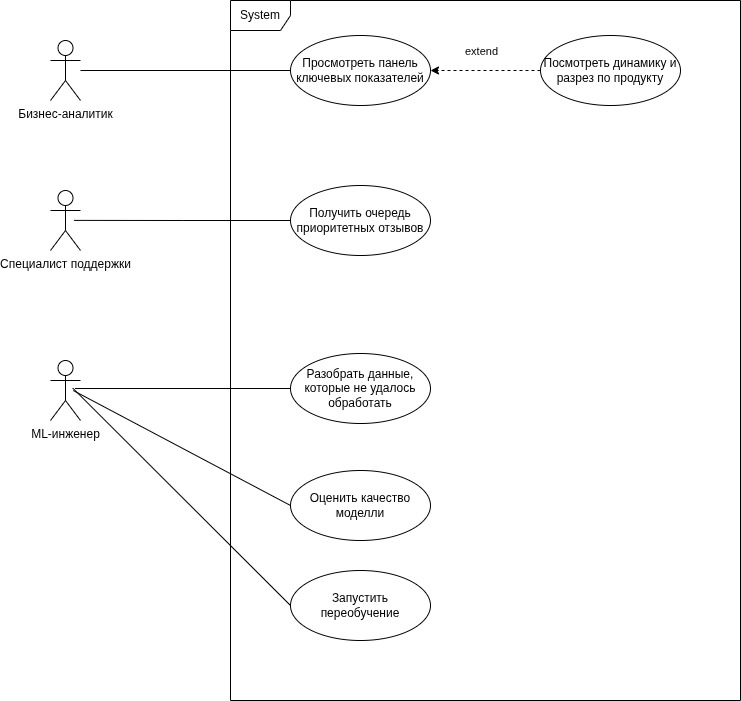
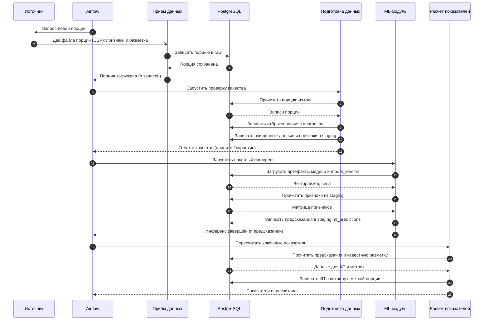

# 1 Архитектурно-аналитический блок 

## 1.1 Проектирование жизненного цикла ML-модели

| этап жизненного цикла модели | описание                                                                                                                                                                                                                                                                                                                                                                                                                                                                   |
| ---------------------------- | -------------------------------------------------------------------------------------------------------------------------------------------------------------------------------------------------------------------------------------------------------------------------------------------------------------------------------------------------------------------------------------------------------------------------------------------------------------------------- |
| Бизнес-метрика               | Оптимизируется удержание клиентов — снижение ожидаемых потерь выручки от оттока. Классификатор по отзыву определяет эмоциональный окрас отзыва, что позволяет определить долю клиентов, которые имеют повышенный шанс уйти из банка. Трансляция в метрики машинного обучения: ROC-AUC как основная метрика выбора модели, PR-AUC и F2-мера как вспомогательные, Brier Score для калибровки вероятностей после выбора рабочего порога. |
| Источники и поставка данных  | Отзывы клиентов из внешних источников (Banki.ru, Sravni.ru, ВКонтакте, Одноклассники и др.) от действующих клиентов Т-Банка о качестве продуктов, услуг и клиентского сервиса. Обновление происходит по мере появления новых публикаций. На инференсе модель получает только текст и контекст; оценка эмоции используется исключительно как разметка при обучении, а применяется модель к потоку, где разметка появляется с задержкой.                                     |
| Обучение и валидация         | Используется временное разбиение. Исходная часть делится по датам в пропорции 80 на 20. Гиперпараметры подбираются кросс-валидацией на пять блоков внутри обучающей части: проверочный блок получает около 16,7 процента обучающей части, а обучение каждый раз выполняется на всех более ранних записях. Артефакты векторайзер и веса сохраняются локально.                                                                                                             |
| Эксплуатация                 | Предсказания заказчку поставляются в виде пакетного расчёта. Оркестратор ежедневно забирает новые порции данных, отправляет в модели и складывает предсказания (вероятность оттока, ожидаемый балл для каждого отзыва) в витрину данных DWH. Затем на основе данных из витрины данных формируются дашборты, где бизнес видит агрегированные KPI и списки клиентов для проработки.                                                                                          |
| Мониторинг                   | Дрейф данных вызывают такие внешние факторы, как изменение распределения длины отзывов, появление нового сленга/продуктов, сдвиг в пропорциях источников (например, резкое увеличение отзывов из ВК), изменение старых продуктов. Для решения проблемы дрейфа данных будет запускаться цикл переобучения. Условия запуска: по расписанию (раз в месяц) и по событию (падение метрик моделей ниже порога (после появления истинной разметки)).                              |
## 1.2 Выбор и анализ архитектурных подходов

Разрабатываемая система решает задачу бинарной классификация. На этапе инференса модель получает только текст отзыва и мета-данные. Результатом работы системы являются эмоциональная окраска нового отзыва, которые агрегируются в витрине данных и визуализируются в BI-дашбордах для бизнес-аналитиков и специалистов поддержки.

Поток данных начинается с внешних источников отзывов, откуда новые порции данных загружаются в сырой слой PostgreSQL. Далее Python-пайплайн, оркестрируемый через Airflow, выполняет очистку данных и переносит их в слой `staging`, где хранятся обработанные отзывы и извлечённые признаки. На этом же слое формируется материализованная таблица, объединяющая очищенные отзывы с истинной разметкой для обучения моделей. Обученные модели применяются к новым порциям данных в режиме инференса, а предсказания вместе с версией модели записываются в слой обработанных данных (`staging`). Витрина данных строится на таблицах слоя обработанных данных. BI-система Redash подключается к витрине по SQL и строит дашборды с ключевыми показателями: долей клиентов в зоне риска, ожидаемыми потерями выручки, распределением прогнозируемых оценок. По мере поступления истинной разметки (с задержкой в несколько дней или недель) слой обработанных данных обогащается фактическими значениями, что позволяет рассчитывать метрики качества модели и принимать решение о переобучении по расписанию или при деградации метрик.

Представление структуры проекта в виде схемы:

## 1.3 Обзор и обоснование MLOps-инструментов

| Инструмент                    | Функция                                                                           | Обоснованеие                                                                                                                                                                                                                                                                                                   |
| ----------------------------- | --------------------------------------------------------------------------------- | -------------------------------------------------------------------------------------------------------------------------------------------------------------------------------------------------------------------------------------------------------------------------------------------------------------- |
| Python (pandas, scikit-learn) | Ядро вычислений: очистка данных, генерация признаков, обучение и инференс моделей | Простота в написании и сопровождении кода. Широкий набор инструментов.                                                                                                                                                                                                                                         |
| Airflow                       | Оркестрация пайплайна                                                             | Задачи пайплайна зависимы по порядку. Airflow описывает эти зависимости, автоматически следит за порядком, повторяет упавшие шаги и ведёт журнал запусков. Без него пришлось бы писать самодельный планировщик.                                                                                                |
| PostgreSQL                    | Хранение данных                                                                   | Одна СУБД закрывает и сырые данные, и витрину для BI — не нужно поддерживать несколько систем. SQL-агрегации выполняются внутри БД, а не в Python, что ускоряет обработку. Поддерживает схемы, транзакции и одновременный доступ из Python-пайплайна и Redash. Открытая лицензия — нулевая стоимость владения. |
| DBeaver                       | Клиент СУБД: развёртывание БД, ER-диаграмма, SQL-запросы                          | Визуально проверяет физическую схему без написания кода. Универсален: работает и с SQLite, и с PostgreSQL, поэтому не создаёт привязки к конкретной СУБД.                                                                                                                                                      |
| Redash                        | BI-система                                                                        | GUI для удобного просмотра полученных результатов от модели и аналитических запросов. Ключевой плюс: работает напрямую через SQL к PostgreSQL — не нужен отдельный слой загрузки данных в BI.                                                                                                                  |
| Docker                        | Контейниризация                                                                   | Для воспроизводимости системы и управляемости.                                                                                                                                                                                                                                                                 |
| Git                           | Система контроля версий                                                           | Версионирование кода и данных.                                                                                                                                                                                                                                                                                 |

| Функция                | Выбрано          | Альтернатива                        | Почему отклонена                                                                                                                                                                       |
| ---------------------- | ---------------- | ----------------------------------- | -------------------------------------------------------------------------------------------------------------------------------------------------------------------------------------- |
| Оркестрация            | **Airflow**      | cron, Prefect, Dagster              | cron не описывает зависимости между шагами и не даёт журнала запусков; Prefect/Dagster — современнее, но Airflow — стандарт индустрии.                                                 |
| Хранилище              | **PostgreSQL**   | SQLite, MySQL                       | SQLite не выдерживает одновременный доступ из Redash и пайплайна (блокировки на запись); MySQL не даёт преимуществ перед PostgreSQL при меньшем наборе возможностей (нет удобных схем) |
| Клиент СУБД            | **DBeaver**      | psql, pgAdmin                       | psql — только терминал, не строит ER-диаграмму; pgAdmin привязан к PostgreSQL и менее удобен для импорта CSV                                                                           |
| BI                     | **Redash**       | Yandex DataLens, Power BI, Superset | DataLens и Power BI требуют облака/аккаунта и ломают принцип локального запуска; Superset тяжелее в настройке при том же результате для одного дашборда                                |
| Контейнеризация        | **Docker**       | venv, Conda                         | venv/Conda изолируют только Python, но не PostgreSQL и Airflow — воспроизводимость системы целиком не достигается                                                                      |
| Версионирование данных | **Git**          | DVC, Git LFS                        | Датасет 30 МБ — DVC требует внешнего хранилища и усложняет развёртывание; LFS избыточен на таком объёме.                                                                               |
| ML-фреймворк           | **scikit-learn** | PyTorch, CatBoost                   | Задача — TF-IDF + логистическая регрессия и порядковая регрессия; глубокие сети здесь избыточны и требуют GPU                                                                          |

Выбранный стек снижает стоимость сопровождения и гарантирует воспроизводимость за счёт устранения избыточных слоёв и фиксации версий всех компонентов. Единая СУБД PostgreSQL хранит данные всех трёх уровней (raw/staging/marts) в одной системе с разделением через схемы, что исключает синхронизацию между хранилищами и риск рассогласованности. Airflow централизует управление зависимостями между шагами пайплайна: отказ этапа фиксируется в журнале и перезапускается автоматически, а сам DAG описывается в Python и версионируется через Git, что исключает расхождение логики между окружениями. BI-система Redash работает напрямую через SQL к витрине, устраняя дополнительный слой выгрузки. Все компоненты имеют открытые лицензии и упакованы в Docker-контейнеры: docker-compose поднимает PostgreSQL, Airflow и Redash в фиксированных версиях на любой машине, исключая ошибки. Git версионирует и код, и данные, что позволяет воспроизвести любой эксперимент. SQL-скрипты в папке `sql/` воспроизводят структуру базы данных из кода, а не через ручное создание в GUI, гарантируя идентичность физической модели на любом окружении.

# 2 Данные и разведочный анализ

## 2.1 Данные и сценарий их обновления

Одна порция данных является выгрузкой данных за произвольный период времени. Целевая переменная неизвестна в момент поступления порции.

## 2.2 Предметный разведочный анализ данных

- ноутбук EDA

## 2.3 Требования к качеству данных и ключевые показатели

| №   | Признак(и)       | Требование                                                        | Действие при нарушении                                        |
| --- | ---------------- | ----------------------------------------------------------------- | ------------------------------------------------------------- |
| 1   | `review_text`    | Не пустой и не короче 20 символов                                 | Карантин                                                      |
| 2   | `review_text`    | В системе нет отзыва с таким же текстом                           | Карантин                                                      |
| 3   | `review_dttm`    | Парсится как дата, не в будущем, не старше 3 лет от даты порции   | Карантин                                                      |
| 4   | `product`        | Значение из фиксированного справочника, без регистровых вариантов | Приведение к справочнику; значение вне справочника — карантин |
| 5   | `review_source`  | Значение из справочника площадок                                  | Карантин                                                      |
| 6   | `review_emotion` | Значение из двух допустимых: позитивный или негативный            | Карантин                                                      |

**Карантин** — отдельная таблица (схема `quarantine`), куда попадает каждая исключённая запись целиком вместе с причиной отклонения и датой порции. Ничего не удаляется: разбор выполняет человек, после чего запись либо правится и возвращается в поток, либо закрывается.

| Показатель | Как рассчитывается | Использует модель | Какое решение помогает принять |
|---|---|---|---|
| Доля негативных отзывов | Отзывов с `p(негатив) ≥ 0.5` / отзывов с текстом за порцию | Да | Масштаб претензионного потока, план загрузки поддержки |
| Топ продуктов по прогнозному негативу | Доля `p ≥ 0.5` в разрезе `product`, продукты с n ≥ 30 | Да | Куда направить продуктовую команду |
| Дельта доли негатива к предыдущей порции | `share_t − share_(t−1)`, п.п. | Да | Триггер разбора инцидента и внепланового переобучения |
| Доля карантина | Записей в карантине / записей порции | Нет | Качество входных данных, разбор с поставщиком |
| Доля известной разметки | Записей с заполненной `review_emotion` / всего записей | Нет | Задержка разметки, готовность к переобучению |

## 2.4 Требования к системе

| ID   | Требование                                                                                                                                                 | Группа           | Способ проверки                                             |
| ---- | ---------------------------------------------------------------------------------------------------------------------------------------------------------- | ---------------- | ----------------------------------------------------------- |
| F-01 | Система сохраняет поступившую порцию в слой "raw" с меткой порции, не перезаписывая ранее загруженные данные                                               | Функциональное   | Загрузить две порции, проверить наличие обеих в слое "raw"  |
| F-02 | Система проверяет каждую запись порции по требованиям качества и переносит нарушившие в карантин с указанием причины                                       | Функциональное   | Демонстрация на порции с известными нарушениями             |
| F-03 | Система нормализует справочники, удаляет дубликаты.                                               | Функциональное   | Сверка числа записей до и после обработки                   |
| F-04 | Система обучает модель на данных с разметкой и сохраняет артефакты и метрики с версией модели.                                                             | Функциональное   | Проверка сохранённых артефактов                             |
| F-05 | Система добавляет поступившую истинную разметку к ранее обработанным записям в слое обработанных данных (`staging`)                                                            | Функциональное   | Число записей с разметкой выросло на размер порции разметки |
| F-06 | Система присваивает каждой записи из обработанного слоя данных вероятность негатива, версию модели и сохраняет результат в слой обработанных данных (`staging`)                  | Функциональное   | Демонстрация записей в витрине данных                       |
| F-07 | Переобучение не изменяет ранее записанные предсказания                                                                                                     | Функциональное   | Запрос данных по двум версиям модели                        |
| F-08 | После инференса система пересчитывает ключевые показатели и пишет их в витрину с меткой порции                                                             | Функциональное   | Демонстрация витрины                                        |
| F-09 | Панель отображает текущее значение и динамику ключевых показателей по порциям                                                                              | Функциональное   | Демонстрация                                                |
| N-01 | После завершения ETL показатели на панели обновлены не позднее чем через 15 минут                                                                          | Нефункциональное | Замер времени                                               |
| N-02 | Падение шага пайплайна не теряет порцию: перезапуск продолжает с последнего успешного шага, порция гарантированно обрабатывается не более чем за 2 попытки | Нефункциональное | Искусственное падение пайплайна, проверка восстановления    |
| D-01 | `review_text` не пустой и не короче 20 символов                                                                                                            | Качество данных | Демонстрация на порции с известными нарушениями             |
| D-02 | В системе нет отзыва с таким же `review_text`                                                                                                              | Качество данных | Демонстрация на порции с известными нарушениями             |
| D-03 | `review_dttm` парсится как дата, не в будущем, не старше 3 лет от даты порции                                                                              | Качество данных | Демонстрация на порции с известными нарушениями             |
| D-04 | Значение `product` из фиксированного справочника, без регистровых вариантов                                                                                | Качество данных | Демонстрация на порции с известными нарушениями             |
| D-05 | Значение `review_source` из справочника площадок                                                                                                           | Качество данных | Демонстрация на порции с известными нарушениями             |

## 2.5. Архитектура системы

### 2.5.1 Логическая архитектура

| Компонент системы             | Назначение                                                               | Входы                                                                   | Выходы                                                                     | Реализация |
| ----------------------------- | ------------------------------------------------------------------------ | ----------------------------------------------------------------------- | -------------------------------------------------------------------------- | ---------- |
| Приём данных                  | Загрузка данных из источника в хранилище                                 | Выгрузка порции от источника                                            | Порция в слое сырых данных с меткой порции                                 | ПР-3       |
| Хранилище                     | Хранение сырых, обработанных данных и предсказаний модели                | Сырые данные, обработанные данные, предсказания, разметка               | Обработанные данные, таблица признаков для обучения, витрина для аналитики | ПР-3       |
| Подготовка данных и признаков | Проверка качества, очистка, нормализация справочников, таблица признаков | Порция из слоя сырых данных                                             | Записи в слой обработанных данных или  в карантин                          | ПР-3       |
| ML-модуль                     | Обучение модели и пакетный инференс                                      | Признаки с разметкой — обучение; без разметки — инференс                | Артефакты модели с версией; предсказания                                   | ПР-3       |
| Расчёт показателей            | Пересчёт ключевых показателей системы и метрик качества модели           | Предсказания из слоя обработанных данных (`staging`), истинная разметка | Ключевые показатели в витрине с меткой порции; метрики по версиям модели   | ПР-3       |
| Панель                        | Отображение показателей пользователю                                     | Витрина показателей                                                     | Дашборд: значения и динамика по порциям                                    | ПР-4       |
| Оркестратор                   | Запуск этапов системы в нужном порядке                                   | Расписание и граф зависимостей (DAG)                                    | Запущенные задачи, журнал запусков                                         | ПР-3       |

### 2.5.2 Диаграммы

Диаграмма С4 уровня контекста

Диаграмма С4 уровня контейнеров

Диаграмма вариантов использования UML

Диагрмма последовательности UML для основного сценария обработки новой порции данных

Новая порция попадает в слой сырых данных, после чего те же шаги обработки, что и при обучении, переносят её в слой обработанных данных и обогащают предсказаниями модели, а витрина данных строится на таблицах слоя обработанных данных. Пересчёт ключевых показателей выполняется сразу после инференса или после получения разметки и пишется в витрину с меткой порции, поэтому каждый запуск добавляет новую точку динамики, не изменяя предыдущие. Redash читает витрину напрямую по SQL, так что панель обновляется вместе с данными без отдельного слоя загрузки.

## 2.6. Пайплайн обработки данных и план признаков

Диаграммы деятельности UML

| Шаг пайплайна                                                        | Вход                                                   | Действие                                                                                                                                                                           | Выход                                                                 |
| -------------------------------------------------------------------- | ------------------------------------------------------ | ---------------------------------------------------------------------------------------------------------------------------------------------------------------------------------- | --------------------------------------------------------------------- |
| Считать данные                                                       | Два файла порции (CSV): файл признаков и файл разметки | Чтение файлов, приведение колонок к типам, проставление метки порции                                                                                                               | Таблицы исходных данных в слое сырых данных (raw) и метка порции      |
| Проверка требований к качеству данных                                | Таблицы исходных данных порции                         | Проверка записей признаков по требованиям 1–3 и 5 табл. 2.3, записей разметки по требованиям 4 и 6                                                                                 | Отчёт о проверке: принятые записи и отбракованные с указанием причины |
| Сформировать данные для карантина: запись, причина, дата обработки   | Отбракованные записи и причина отклонения              | Формирование строки карантина: запись целиком, причина отклонения, дата порции                                                                                                     | Набор записей для таблицы `quarantine`                                |
| Приведение данных к формату справочников                             | Принятые записи                                        | Нормализация `product` и `review_source` по справочникам: регистр, пробелы, канонические значения                                                                                  | Принятые записи с каноническими значениями справочников               |
| Формирование признаков                                               | Принятые записи после нормализации                     | Расчёт `words_cnt`, `avg_word_len` и `exclaim_cnt`, one-hot кодирование `review_source` и TF-IDF по `review_text` выполняются внутри конвейера модели при обучении и при инференсе | Матрица признаков                                                     |
| Сформировать обработанные данные из исходных полей записи и разметки | Очищенные отзывы и очищенная разметка                  | Соединение отзывов и разметки по ключу `id_client` и `review_dttm` в одну строку                                                                                                   | Таблица подготовленных данных                                         |
| Сохранить данные в слой обработанных данных                          | Таблица подготовленных данных                          | Запись в `staging` по ключу `id_client` + `review_dttm`                                                                                                                            | Записи в `staging`, готовые к обучению модели                         |
| Сохранить данные в карантин                                          | Набор записей карантина                                | Запись в `quarantine`: запись целиком, причина, дата порции                                                                                                                        | Записи в `quarantine`, доступные для разбора человеком                |

Шаги от чтения порции до записи в `staging` и `quarantine` одинаковы для обучения и для обработки новой порции: считывание файлов, проверка требований 1–3 и 5 для записей признаков, 4 и 6 для записей разметки, формирование записи карантина, приведение категориальных признаков к справочникам, расчёт признаков, сборка строки подготовленных данных и запись в хранилище выполняются одним и тем же кодом. При обучении к этому добавляются операции, которых нет в потоке новой порции: временное разбиение на обучающее и валидационное окно, подбор гиперпараметров по кросс-валидации внутри тренировочного окна, собственно обучение и сохранение артефактов вместе с метриками и версией модели.

Пайплайн воспроизводим за счёт того, что параметры модели сохраняются как артефакт с версией - в любой момент можно вернуться к определённой версии. Запуск выполняется одной командой через оркестратор, где граф зависимостей, код и DDL-скрипты лежат в Git, а окружение зафиксировано версиями в Docker-образах, поэтому на любой машине поднимается одинаковый стек.

| Признак         | Исходные данные | Преобразование                                                                                                                                  | Гипотеза                                                                                                                                                                         |
| --------------- | --------------- | ----------------------------------------------------------------------------------------------------------------------------------------------- | -------------------------------------------------------------------------------------------------------------------------------------------------------------------------------- |
| `words_cnt`     | `review_text`   | Разбиение текста по пробелам и подсчёт числа слов.                                                                                              | Негативные отзывы длиннее позитивных. Число слов — прямая производная длины текста, устойчивая к длине отдельного слова.                                                         |
| `avg_word_len`  | `review_text`   | Сумма длин слов, делённая на число слов.                                                                                                        | Средняя длина слова — производный признак от длины отзыва, выделенный по результатам проверки гипотезы 1 как дополнительная характеристика текста.                               |
| `exclaim_cnt`   | `review_text`   | Подсчёт восклицательных знаков в тексте. | Восклицательные знаки передают интенсивность высказывания и не зависят от состава словаря, поэтому признак дополняет TF-IDF на резких отзывах. |

Обработка новых данных должна выполняться теми же шагами, что и обработка обучающих, поскольку иначе новая порция получила бы признаки, посчитанные по другим правилам, и модель на инференсе увидела бы не то распределение, на котором училась. Также такой подход позволяет сократить сложность системы за счёт переиспользования одного и того же кода для решения двух задач.

# ОБУЧЕНИЕ И СРАВНЕНИЕ ML-МОДЕЛЕЙ

## План экспериментов

### Метрики

Бизнес-метрика проекта состоит в снижении ожидаемых потерь выручки от оттока. Классификатор по тексту отзыва оценивает вероятность негатива, что позволяет видеть долю клиентов с повышенным риском ухода и приоритет обработки обращений. Метрики машинного обучения выбираются по тому, насколько они отражают эту величину.

Основная метрика ROC-AUC. Она измеряет качество ранжирования отзывов по вероятности негатива и не зависит от выбранного порога, поэтому по ней сравниваются модели до того, как определена цена ошибок и рабочий порог. Ранжирование связано с бизнес-метрикой напрямую: очередь на обработку и расчёт доли негатива строятся по упорядоченным вероятностям.

Вспомогательные метрики PR-AUC и F2-мера. PR-AUC показывает качество выделения негативных отзывов при несбалансированных классах и опирается на долю негатива как базовую линию, поэтому она приводится вместе с этой долей в проверочном блоке. F2-мера при фиксированном пороге 0,5 отражает приоритет полноты над точностью, потому что пропуск недовольного клиента обходится дороже ложного срабатывания.

Brier Score в сравнении моделей не участвует и применяется на этапе выбора рабочего порога как мера калибровки вероятностей.

### Стратегия валидации

Применяется временное разбиение. Записи сортируются по дате публикации отзыва, очищаются от пустых текстов, текстов короче 20 символов и повторов, после чего первые 80 процентов по времени образуют обучающую часть, последние 20 процентов отложенную тестовую. При текущем объёме это 26 321 и 6 581 запись. Тестовая часть не участвует в выборе модели и в подборе гиперпараметров и применяется один раз для итоговой оценки.

Случайное разбиение не используется. Оно допускает попадание более поздних отзывов в обучение, а более ранних в проверку, из-за чего оценка перестаёт отражать работу модели на будущих данных.

### Схема кросс-валидации

Внутри обучающей части применяется TimeSeriesSplit на пять блоков с расширяющимся окном. Проверочный блок всегда следует за обучающими данными и содержит 4 386 записей, около 16,7 процента обучающей части, а обучающее окно начинается с начала истории и растёт от 4 391 до 21 935 записей.

Схема соответствует временной зависимости данных: на каждом шаге модель обучается только на прошлом и проверяется на непосредственно следующем за ним периоде, что повторяет порядок переобучения в эксплуатации.

По каждому блоку записываются ROC-AUC, PR-AUC, F2 при пороге 0,5 и доля негатива, итогом считается среднее значение и стандартное отклонение по блокам.

### Стратегия исключения утечек

Признаки, которые появляются после публикации отзыва или прямо раскрывают целевую переменную, в модель не включаются. 

Оценка параметров предобработки выполняется только внутри обучающего фрагмента. TF-IDF, кодирование категориальных признаков и масштабирование объединены с моделью в Pipeline и обучаются заново на каждом блоке кросс-валидации, поэтому проверочные данные не влияют на словарь и веса. Оценка этих параметров по всей выборке до разбиения дала бы модели сведения о проверочных записях.

Дубликаты текстов удаляются до разбиения, поэтому одинаковые отзывы не попадают одновременно в обучение и проверку. Повторы по id_client утечкой не являются, так как при временном разбиении все отзывы клиента в проверочном блоке опубликованы позже его отзывов в обучающем, и модель работает только с прошлым.

### Выбор модели

Базовое решение задаёт нижнюю границу качества, ниже которой модель не принимается в систему. Используются два варианта. Первый относит все отзывы к преобладающему классу, позитивному. Доля верных ответов при этом составляет 62,6 процента, ROC-AUC равна 0,5, а F2-мера равна 0, поскольку негативные отзывы не находятся вовсе. Второй опирается на проверенную гипотезу 1, по которой негативные отзывы длиннее позитивных. Отзыв относится к негативу, если его длина превышает медиану обучающей части, 439 символов. На обучающей части правило даёт точность 0,482, полноту 0,644 и F2-меру 0,603. Модель считается пригодной, если превосходит оба базовых решения по ROC-AUC и F2-мере на кросс-валидации.

Порог длины считается только по обучающей части, поэтому в проверочные блоки сведения о их длинах не попадают.

Итоговая модель выбирается по наибольшему среднему значению ROC-AUC на кросс-валидации. Если различия между лидерами не превышают 0,005, предпочтение отдаётся более простой и быстрой модели, потому что такой разрыв лежит в пределах разброса между блоками.

Дополнительными условиями выбора служат PR-AUC с учётом доли негатива в блоке и F2 при пороге 0,5, поскольку модель не должна улучшать ранжирование за счёт качества на рабочем пороге. Модель, которая не превосходит базовое решение по ROC-AUC и F2, в качестве итоговой не рассматривается.

Выбранная модель обучается на всей обучающей части с фиксированным начальным значением генератора, сохраняется вместе с параметрами и описанием и воспроизводится одной командой. Выбранная схема даёт сопоставимую оценку качества для всех семейств и исключает попадание сведений из проверочных блоков в обучение, поэтому результаты кросс-валидации сравнимы между собой и переносятся на поток новых отзывов.

## Обоснование семейств моделей

Семейства моделей различаются требованиями к предобработке и поведением на разреженных текстовых признаках. Сопоставление приведено в таблице.

| Модель | Требования к предобработке | Сильные стороны | Ожидаемые проблемы на данных |
|---|---|---|---|
| Логистическая регрессия с L1 и L2 | полный TF-IDF, масштабирование числовых признаков | интерпретируемость, скорость, устойчивость на разреженных данных | не учитывает взаимодействия слов, слабее на нелинейных конструкциях |
| k ближайших соседей | снижение размерности через SVD, масштабирование | простая нелинейная модель | на разреженном TF-IDF расстояния теряют смысл, медленный на десятках тысяч записей |
| Дерево решений | SVD, масштабирование не требуется | интерпретируемость, нелинейность | переобучается без ограничения глубины, плохо делит разреженный текст |
| Наивный байесовский классификатор | полный TF-IDF, масштабирование не требуется | скорость, работает при малом числе наблюдений | предположение о независимости признаков, вероятности плохо калиброваны |
| Случайный лес | SVD, масштабирование не требуется | устойчивость к переобучению, нелинейность | на разреженном тексте проигрывает линейным моделям, дороже по памяти |
| Градиентный бустинг | SVD, масштабирование не требуется | нелинейность, обычно высокая точность | требователен к подбору гиперпараметров, медленнее, вероятности требуют калибровки |

Ожидается, что лучшей окажется логистическая регрессия на полном TF-IDF. Сигнал негатива выражен в лексике и близок к линейному по признакам, а размерность текстовых признаков слишком велика для деревьев и соседей. Ансамбли могут сократить разрыв, но существенного превосходства над линейной моделью не ожидается.

## Учет экспериментов

Эксперименты выполняются прогоном по исторической части (history.csv) в директории data/incoming, логика обучения вынесена в модули src/models.py и src/experiments.py. Прогон вызывает готовые функции и не содержит собственного кода подготовки данных, поэтому сравнение моделей воспроизводится по коду и по сохранённым записям запусков.

Пайплайн подготовки задан одной структурой. Он включает TF-IDF по тексту отзыва, one-hot кодирование источника, три числовых признака и классификатор на последнем шаге. TF-IDF ограничен 30 000 признаками, использует униграммы и биграммы, порог частоты 2 и сублинейное взвешивание. Для нелинейных семейств текстовое представление заменяется усечённым через сингулярное разложение до 100 компонент, это задаётся параметром text_repr. Кодирование источника выполнено так, что неизвестная категория в новой порции не вызывает ошибки. На каждый блок кросс-валидации создаётся новый экземпляр пайплайна, поэтому словарь TF-IDF и параметры кодирования оцениваются только на обучающем фрагменте блока. Каждый эксперимент добавляет строку в журнал experiments/log.jsonl. В строке фиксируются идентификатор запуска, дата и время, семейство, гиперпараметры, текстовое представление, признак использования числовых признаков, схема валидации, число записей в наборе, в обучающей и тестовой частях, источник данных, начальное значение генератора, метрики каждого блока с числом записей и временем обучения, средние значения и стандартное отклонение по блокам. Перебираемые значения для подбора задаются в модуле models и в журнал не пишутся. Сводная таблица runs.csv и таблица по блокам folds.csv собираются из журнала функцией build_tables, поэтому сводка всегда соответствует исходным записям. В runs.csv одна строка на эксперимент со средними значениями и разбросом метрик, в folds.csv одна строка на блок кросс-валидации. Каталог версионируется вместе с кодом, что позволяет восстановить любой эксперимент по коммиту и файлу данных.

После сравнения моделей оформляется запись о решении в experiments/decision.md. В ней указываются выбранный идентификатор запуска, значения метрик, по которым сделан выбор, и таблица остальных запусков. Эта запись служит ответом на вопрос, почему выбрана конкретная модель, и используется при подготовке отчёта. Итоговая модель сохраняется как Pipeline целиком, векторайзер и классификатор в одном объекте joblib в каталоге models. Рядом размещается model_v1.json с версией, датой, ссылкой на запуск, гиперпараметрами, набором признаков, числом записей, версией scikit-learn, метриками на кросс-валидации и именем файла артефакта, а указатель models/current.json задаёт действующую версию для инференса. Откат сводится к переключению указателя на предыдущую версию.

Итоговая модель обучается отдельным скриптом src/train_final.py на всей обучающей части с фиксированным начальным значением генератора, поэтому артефакт не зависит от порядка запусков и собирается одной командой. Журнал запусков и отдельное описание модели позволяют воспроизвести любой эксперимент по сохранённым параметрам и вернуться к предыдущей версии переключением указателя, не повторяя обучение.

## Реализация пайплайна и признаков

Подготовка данных и модель объединены в объект Pipeline. Первым шагом рассчитываются признаки, вторым применяется ColumnTransformer, последним стоит классификатор. Внутри ColumnTransformer три ветви: числовые признаки со стандартизацией, текст отзыва с TF-IDF на 30 000 признаков с униграммами и биграммами, источник с one-hot кодированием. Для нелинейных семейств текстовое представление сжимается усечённым сингулярным разложением до 100 компонент, потому что на разреженных векторах расстояния и пороговые правила теряют смысл.

Три признака рассчитываются из текста отзыва. `words_cnt` равно числу слов при разбиении по пробелам. `avg_word_len` равно отношению числа непробельных символов к числу слов. `exclaim_cnt` равно числу восклицательных знаков и отражает интенсивность высказывания. Признак `product` в модель не включён, поскольку приходит вместе с разметкой и на инференсе недоступен.

Обработка новой порции выполняется двумя DAGами. `review_ingestion` запускается по расписанию, просматривает каталог `data/incoming/features` в порядке `history.csv`, затем `batch_N.csv` по возрастанию номера, пропускает файлы, уже загруженные по контрольной сумме, регистрирует новую порцию и записывает строки в `raw.review`, после чего порция получает статус `processing`. `staging` забирает порции в этом статусе, применяет правила качества, заполняет `staging.review_clean` и карантин, собирает `staging.training_set` тем же кодом, что используется при обучении, и переводит порцию в статус `done`. Поток разметки устроен так же: `enrichment_ingestion` читает каталог `data/incoming/labels` и загружает порцию в `raw.review_enrichment` только после того, как отзывы этой порции уже загружены; `staging` проверяет разметку и дополняет `staging.training_set`. Упавшая порция остаётся в статусе `processing`, поэтому следующий запуск повторяет её без ручного вмешательства.

Исходная выгрузка разделена на два набора с совпадающими именами файлов. В каталоге `features` остаются ключи `id_client` и `review_dttm`, текст отзыва и площадка, то есть поля, из которых строятся признаки модели. В каталоге `labels` остаются ключи, продукт и целевая переменная `review_emotion`. Продукт в модель не входит, но остаётся в разметке, потому что его проверяют правила качества. Остальные девятнадцать колонок выгрузки не используются ни на одном шаге и в наборы не включены.

Повторяемость проверена двумя последовательными запусками обучения на одних данных. Вероятности на первых 500 записях совпали, максимальное расхождение равно 0,000000, хеши SHA-256 сохранённых артефактов совпали.

## Базовое решение и линейные модели

Наиболее частый класс даёт долю верных ответов 0,626, ROC-AUC 0,500 и нулевую полноту. Правило длины с порогом 439 символов даёт точность 0,482, полноту 0,644, F2-меру 0,603 и ROC-AUC 0,615.

Для линейной модели обучены два варианта регуляризации. При сильной регуляризации L1 с C = 0,001 ненулевых коэффициентов остаётся 2 из 30 021 при качестве 0,730. С ростом C число ненулевых коэффициентов увеличивается, при C = 0,1 их 57. Начиная с C = 1 качество обеих моделей выходит на плато около 0,998. Модель L2 сохраняет все коэффициенты и при одинаковых C не уступает L1 по качеству. Модель L2 показывает средний ROC-AUC 0,993 на кросс-валидации.

Наибольший положительный вес имеют «прошу», «не рекомендую» и «заблокировали», наибольший отрицательный вес имеют «спасибо», «быстро» и «вернули». Знаки коэффициентов согласуются с выводами разведочного анализа. Числовые признаки влияют слабее слов, вес числа слов положителен, то есть негативные отзывы длиннее, веса средней длины слова и числа восклицательных знаков отрицательны.

## Модели классификации и ансамбли

Кроме линейной модели обучены наивный байесовский классификатор со средним ROC-AUC 0,994, метод k ближайших соседей с 0,966, дерево решений с 0,941, случайный лес с 0,989 и градиентный бустинг с 0,993.

Зависимость качества дерева решений от глубины показывает переобучение. До глубины 6 качество растёт на обеих выборках, затем на обучающей части оно достигает 0,998, а на проверочной падает до 0,930 при глубине 15.

Польза новых признаков оценена сравнением моделей на исходном наборе признаков и на наборе с добавленными признаками. Для логистической регрессии ROC-AUC равен 0,994 без признаков и 0,993 с признаками; для градиентного бустинга ROC-AUC равен 0,992 без признаков и 0,993 с признаками. Изменение качества не превышает 0,001 и лежит в пределах разброса между блоками. Признаки сохранены, поскольку не ухудшают качество за пределами разброса и дают понятные характеристики текста.

## Подбор гиперпараметров

Перебор выполнен для двух лучших семейств; для наивного байесовского классификатора лучшим набором оказался сглаживание 0,1, качество изменилось с 0,994 до 0,995; для логистической регрессии лучшим набором оказался C = 10, L2, качество изменилось с 0,993 до 0,995.

## Сравнение и выбор итоговой модели

Итоговой моделью выбрана логистическая регрессия с параметрами C = 10 и регуляризацией L2. Средний ROC-AUC на кросс-валидации равен 0,995 плюс-минус 0,002, PR-AUC 0,991, F2-мера при пороге 0,5 0,973. Различие с ближайшим вариантом не превышает 0,005, поэтому по правилу выбора предпочтение отдано более простой и быстрой модели.

Гипотеза о превосходстве линейной модели подтвердилась. Модель сохранена в models/model_v1.joblib вместе с описанием, содержащим версию, гиперпараметры, метрики и версию scikit-learn.
