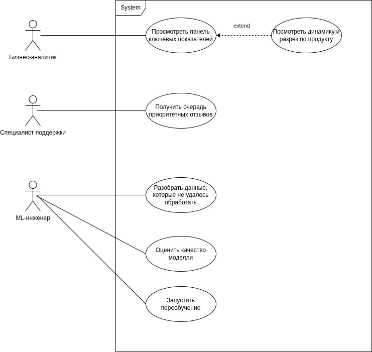
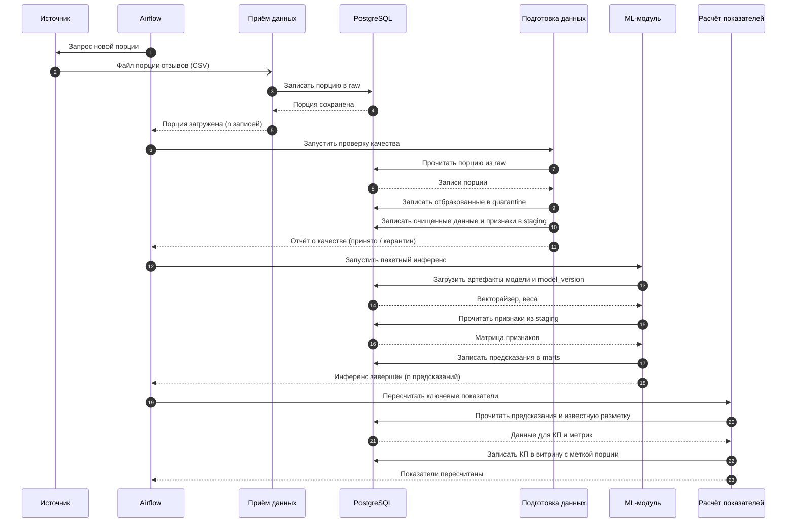
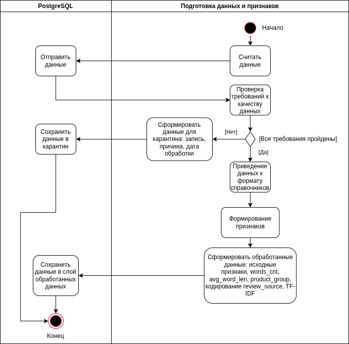

# 1 Архитектурно-аналитический блок 

## 1.1 Проектирование жизненного цикла ML-модели

| этап жизненного цикла модели | описание                                                                                                                                                                                                                                                                                                                                                                                                                                                                   |
| ---------------------------- | -------------------------------------------------------------------------------------------------------------------------------------------------------------------------------------------------------------------------------------------------------------------------------------------------------------------------------------------------------------------------------------------------------------------------------------------------------------------------- |
| Бизнес-метрика               | Оптимизируется удержание клиентов — снижение ожидаемых потерь выручки от оттока. Классификатор по отзыву определяет эмоциональный окрас отзыва, что позволяет определить долю клиентов, которые имеют повышенный шанс уйти из банка. Трансляция в метрики машинного обучения: F2-score (recall важнее precision: пропуск детрактора стоит дороже ложного срабатывания), PR-AUC (сильный дисбаланс классов), Brier Score (калибровка вероятностей для выбора порога риска). |
| Источники и поставка данных  | Отзывы клиентов из внешних источников (Banki.ru, Sravni.ru, ВКонтакте, Одноклассники и др.) от действующих клиентов Т-Банка о качестве продуктов, услуг и клиентского сервиса. Обновление происходит по мере появления новых публикаций. На инференсе модель получает только текст и контекст; оценка эмоции используется исключительно как разметка при обучении, а применяется модель к потоку, где разметка появляется с задержкой.                                     |
| Обучение и валидация         | Используется временное разбиение (Time-Based Split). Модель обучается на историческом срезе (например, Январь-Август), а валидируется на «будущем» (Сентябрь). Это предотвращает утечку из будущего и имитирует прод. Гиперпараметры моделей подбираются через кросс-валидацию внутри тренировочного окна. Артефакты (векторайзер, веса) сохраняются локально.                                                                                                             |
| Эксплуатация                 | Предсказания заказчку поставляются в виде пакетного расчёта. Оркестратор ежедневно забирает новые порции данных, отправляет в модели и складывает предсказания (вероятность оттока, ожидаемый балл для каждого отзыва) в витрину данных DWH. Затем на основе данных из витрины данных формируются дашборты, где бизнес видит агрегированные KPI и списки клиентов для проработки.                                                                                          |
| Мониторинг                   | Дрейф данных вызывают такие внешние факторы, как изменение распределения длины отзывов, появление нового сленга/продуктов, сдвиг в пропорциях источников (например, резкое увеличение отзывов из ВК), изменение старых продуктов. Для решения проблемы дрейфа данных будет запускаться цикл переобучения. Условия запуска: по расписанию (раз в месяц) и по событию (падение метрик моделей ниже порога (после появления истинной разметки)).                              |
## 1.2 Выбор и анализ архитектурных подходов

Разрабатываемая система решает задачу бинарной классификация. На этапе инференса модель получает только текст отзыва и мета-данные. Результатом работы системы являются эмоциональная окраска нового отзыва, которые агрегируются в витрине данных и визуализируются в BI-дашбордах для бизнес-аналитиков и специалистов поддержки.

Поток данных начинается с внешних источников отзывов, откуда новые порции данных загружаются в сырой слой PostgreSQL. Далее Python-пайплайн, оркестрируемый через Airflow, выполняет очистку данных и переносит их в слой `staging`, где хранятся обработанные отзывы и извлечённые признаки. На этом же слое формируется материализованная таблица, объединяющая очищенные отзывы с истинной разметкой для обучения моделей. Обученные модели применяются к новым порциям данных в режиме инференса, а предсказания вместе с версией модели записываются в витрину данных. BI-система Redash подключается к витрине по SQL и строит дашборды с ключевыми показателями: долей клиентов в зоне риска, ожидаемыми потерями выручки, распределением прогнозируемых оценок. По мере поступления истинной разметки (с задержкой в несколько дней или недель) витрина обогащается фактическими значениями, что позволяет рассчитывать метрики качества модели и принимать решение о переобучении по расписанию или при деградации метрик.

Представление структуры проекта в виде схемы:

## 1.3 Обзор и обоснование MLOps-инструментов

| Инструмент                    | Функция                                                                           | Обоснованеие                                                                                                                                                                                                                                                                                                   |
| ----------------------------- | --------------------------------------------------------------------------------- | -------------------------------------------------------------------------------------------------------------------------------------------------------------------------------------------------------------------------------------------------------------------------------------------------------------- |
| Python (pandas, scikit-learn) | Ядро вычислений: очистка данных, генерация признаков, обучение и инференс моделей | Простота в написании и сопровождении кода. Широкий набор инструментов.                                                                                                                                                                                                                                         |
| Airflow                       | Оркестрация пайплайна                                                             | Задачи пайплайна зависимы по порядку. Airflow описывает эти зависимости, автоматически следит за порядком, повторяет упавшие шаги и ведёт журнал запусков. Без него пришлось бы писать самодельный планировщик.                                                                                                |
| PostgreSQL                    | Хранение данных                                                                   | Одна СУБД закрывает и сырые данные, и витрину для BI — не нужно поддерживать несколько систем. SQL-агрегации выполняются внутри БД, а не в Python, что ускоряет обработку. Поддерживает схемы, транзакции и одновременный доступ из Python-пайплайна и Redash. Открытая лицензия — нулевая стоимость владения. |
| DBeaver                       | Клиент СУБД: развёртывание БД, ER-диаграмма, SQL-запросы                          | Визуально проверяет физическую схему без написания кода. Универсален: работает и с SQLite, и с PostgreSQL, поэтому не создаёт привязки к конкретной СУБД.                                                                                                                                                      |
| Redash                        | BI-система                                                                        | GUI для удобного просмотра полученных результатов от модели и аналитических запросов. Ключевой плюс: работает напрямую через SQL к PostgreSQL — не нужен отдельный слой загрузки данных в BI.                                                                                                                  |
| Docker                        | Контейниризация                                                                   | Для воспроизводимости системы и управляемости.                                                                                                                                                                                                                                                                 |
| Git                           | Система контроля версий                                                           | Версионирование кода и данных.                                                                                                                                                                                                                                                                                 |

| Функция                | Выбрано          | Альтернатива                        | Почему отклонена                                                                                                                                                                       |
| ---------------------- | ---------------- | ----------------------------------- | -------------------------------------------------------------------------------------------------------------------------------------------------------------------------------------- |
| Оркестрация            | **Airflow**      | cron, Prefect, Dagster              | cron не описывает зависимости между шагами и не даёт журнала запусков; Prefect/Dagster — современнее, но Airflow — стандарт индустрии.                                                 |
| Хранилище              | **PostgreSQL**   | SQLite, MySQL                       | SQLite не выдерживает одновременный доступ из Redash и пайплайна (блокировки на запись); MySQL не даёт преимуществ перед PostgreSQL при меньшем наборе возможностей (нет удобных схем) |
| Клиент СУБД            | **DBeaver**      | psql, pgAdmin                       | psql — только терминал, не строит ER-диаграмму; pgAdmin привязан к PostgreSQL и менее удобен для импорта CSV                                                                           |
| BI                     | **Redash**       | Yandex DataLens, Power BI, Superset | DataLens и Power BI требуют облака/аккаунта и ломают принцип локального запуска; Superset тяжелее в настройке при том же результате для одного дашборда                                |
| Контейнеризация        | **Docker**       | venv, Conda                         | venv/Conda изолируют только Python, но не PostgreSQL и Airflow — воспроизводимость системы целиком не достигается                                                                      |
| Версионирование данных | **Git**          | DVC, Git LFS                        | Датасет 30 МБ — DVC требует внешнего хранилища и усложняет развёртывание; LFS избыточен на таком объёме.                                                                               |
| ML-фреймворк           | **scikit-learn** | PyTorch, CatBoost                   | Задача — TF-IDF + логистическая регрессия и порядковая регрессия; глубокие сети здесь избыточны и требуют GPU                                                                          |

Выбранный стек снижает стоимость сопровождения и гарантирует воспроизводимость за счёт устранения избыточных слоёв и фиксации версий всех компонентов. Единая СУБД PostgreSQL хранит данные всех трёх уровней (raw/staging/marts) в одной системе с разделением через схемы, что исключает синхронизацию между хранилищами и риск рассогласованности. Airflow централизует управление зависимостями между шагами пайплайна: отказ этапа фиксируется в журнале и перезапускается автоматически, а сам DAG описывается в Python и версионируется через Git, что исключает расхождение логики между окружениями. BI-система Redash работает напрямую через SQL к витрине, устраняя дополнительный слой выгрузки. Все компоненты имеют открытые лицензии и упакованы в Docker-контейнеры: docker-compose поднимает PostgreSQL, Airflow и Redash в фиксированных версиях на любой машине, исключая ошибки. Git версионирует и код, и данные, что позволяет воспроизвести любой эксперимент. SQL-скрипты в папке `sql/` воспроизводят структуру базы данных из кода, а не через ручное создание в GUI, гарантируя идентичность физической модели на любом окружении.

# 2 Данные и разведочный анализ

## 2.1 Данные и сценарий их обновления

Одна порция данных является выгрузкой данных за произвольный период времени. Целевая переменная неизвестна в момент поступления порции.

## 2.2 Предметный разведочный анализ данных

- ноутбук EDA

## 2.3 Требования к качеству данных и ключевые показатели

| №   | Признак(и)      | Требование                                                        | Действие при нарушении                                        |
| --- | --------------- | ----------------------------------------------------------------- | ------------------------------------------------------------- |
| 1   | `review_text`   | Не пустой и не короче 20 символов                                 | Карантин                                                      |
| 2   | `review_text`   | В системе нет отзыва с таким же текстом                           | Карантин                                                      |
| 3   | `review_dttm`   | Парсится как дата, не в будущем, не старше 3 лет от даты порции   | Карантин                                                      |
| 4   | `product`       | Значение из фиксированного справочника, без регистровых вариантов | Приведение к справочнику; значение вне справочника — карантин |
| 5   | `review_source` | Значение из справочника площадок                                  | Карантин                                                      |

**Карантин** — отдельная таблица (схема `quarantine`), куда попадает каждая исключённая запись целиком вместе с причиной отклонения и датой порции. Ничего не удаляется: разбор выполняет человек, после чего запись либо правится и возвращается в поток, либо закрывается.

| Показатель | Как рассчитывается | Использует модель | Какое решение помогает принять |
|---|---|---|---|
| Доля негативных отзывов | Отзывов с `p(негатив) ≥ 0.5` / отзывов с текстом за порцию | Да | Масштаб претензионного потока, план загрузки поддержки |
| Топ продуктов по прогнозному негативу | Доля `p ≥ 0.5` в разрезе `product`, продукты с n ≥ 30 | Да | Куда направить продуктовую команду |
| Дельта доли негатива к предыдущей порции | `share_t − share_(t−1)`, п.п. | Да | Триггер разбора инцидента и внепланового переобучения |
| Доля карантина | Записей в карантине / записей порции | Нет | Качество входных данных, разбор с поставщиком |
| Доля известной разметки | Записей с заполненной `review_emotion` / всего записей | Нет | Задержка разметки, готовность к переобучению |

## 2.4 Требования к системе

| ID   | Требование                                                                                                                                                 | Группа           | Способ проверки                                             |
| ---- | ---------------------------------------------------------------------------------------------------------------------------------------------------------- | ---------------- | ----------------------------------------------------------- |
| F-01 | Система сохраняет поступившую порцию в слой "raw" с меткой порции, не перезаписывая ранее загруженные данные                                               | Функциональное   | Загрузить две порции, проверить наличие обеих в слое "raw"  |
| F-02 | Система проверяет каждую запись порции по требованиям качества и переносит нарушившие в карантин с указанием причины                                       | Функциональное   | Демонстрация на порции с известными нарушениями             |
| F-03 | Система нормализует справочники, удаляет дубликаты и формирует таблицу признаков в слой обработанных данных.                                               | Функциональное   | Сверка числа записей до и после обработки                   |
| F-04 | Система обучает модель на данных с разметкой и сохраняет артефакты и метрики с версией модели.                                                             | Функциональное   | Проверка сохранённых артефактов                             |
| F-05 | Система добавляет поступившую истинную разметку к ранее обработанным записям и в витрину данных                                                            | Функциональное   | Число записей с разметкой выросло на размер порции разметки |
| F-06 | Система присваивает каждой записи из обработанного слоя данных вероятность негатива, версию модели и сохраняет результат в витрину данных                  | Функциональное   | Демонстрация записей в витрине данных                       |
| F-07 | Переобучение не изменяет ранее записанные предсказания                                                                                                     | Функциональное   | Запрос данных по двум версиям модели                        |
| F-08 | После инференса система пересчитывает ключевые показатели и пишет их в витрину с меткой порции                                                             | Функциональное   | Демонстрация витрины                                        |
| F-09 | Панель отображает текущее значение и динамику ключевых показателей по порциям                                                                              | Функциональное   | Демонстрация                                                |
| N-01 | После завершения ETL показатели на панели обновлены не позднее чем через 15 минут                                                                          | Нефункциональное | Замер времени                                               |
| N-02 | Падение шага пайплайна не теряет порцию: перезапуск продолжает с последнего успешного шага, порция гарантированно обрабатывается не более чем за 2 попытки | Нефункциональное | Искусственное падение пайплайна, проверка восстановления    |
| D-01 | `review_text` не пустой и не короче 20 символов                                                                                                            | Качество данных | Демонстрация на порции с известными нарушениями             |
| D-02 | В системе нет отзыва с таким же `review_text`                                                                                                              | Качество данных | Демонстрация на порции с известными нарушениями             |
| D-03 | `review_dttm` парсится как дата, не в будущем, не старше 3 лет от даты порции                                                                              | Качество данных | Демонстрация на порции с известными нарушениями             |
| D-04 | Значение `product` из фиксированного справочника, без регистровых вариантов                                                                                | Качество данных | Демонстрация на порции с известными нарушениями             |
| D-05 | Значение `review_source` из справочника площадок                                                                                                           | Качество данных | Демонстрация на порции с известными нарушениями             |

## 2.5. Архитектура системы

### 2.5.1 Логическая архитектура

| Компонент системы             | Назначение                                                               | Входы                                                     | Выходы                                                                     | Реализация |
| ----------------------------- | ------------------------------------------------------------------------ | --------------------------------------------------------- | -------------------------------------------------------------------------- | ---------- |
| Приём данных                  | Загрузка данных из источника в хранилище                                 | Выгрузка порции от источника                              | Порция в слое сырых данных с меткой порции                                 | ПР-3       |
| Хранилище                     | Хранение сырых, обработанных данных и предсказаний модели                | Сырые данные, обработанные данные, предсказания, разметка | Обработанные данные, таблица признаков для обучения, витрина для аналитики | ПР-3       |
| Подготовка данных и признаков | Проверка качества, очистка, нормализация справочников, таблица признаков | Порция из слоя сырых данных                               | Записи в слой обработанных данных или  в карантин                          | ПР-3       |
| ML-модуль                     | Обучение модели и пакетный инференс                                      | Признаки с разметкой — обучение; без разметки — инференс  | Артефакты модели с версией; предсказания                                   | ПР-3       |
| Расчёт показателей            | Пересчёт ключевых показателей системы и метрик качества модели           | Предсказания из витрины, истинная разметка                | Ключевые показатели в витрине с меткой порции; метрики по версиям модели   | ПР-3       |
| Панель                        | Отображение показателей пользователю                                     | Витрина показателей                                       | Дашборд: значения и динамика по порциям                                    | ПР-4       |
| Оркестратор                   | Запуск этапов системы в нужном порядке                                   | Расписание и граф зависимостей (DAG)                      | Запущенные задачи, журнал запусков                                         | ПР-3       |

### 2.5.2 Диаграммы

Диаграмма С4 уровня контекста

Диаграмма С4 уровня контейнеров

Диаграмма вариантов использования UML

Диагрмма последовательности UML для основного сценария обработки новой порции данных

Новая порция попадает в слой сырых данных, после чего те же шаги обработки, что и при обучении, переносят её в слой обработанных данных и обогащают предсказаниями модели в витрине данных. Пересчёт ключевых показателей выполняется сразу после инференса или после получения разметки и пишется в витрину с меткой порции, поэтому каждый запуск добавляет новую точку динамики, не изменяя предыдущие. Redash читает витрину напрямую по SQL, так что панель обновляется вместе с данными без отдельного слоя загрузки.

## 2.6. Пайплайн обработки данных и план признаков

Диаграммы деятельности UML

| Шаг пайплайна                                                                                                                          | Вход                                      | Действие                                                                                                                                                                                                          | Выход                                                                 |
| -------------------------------------------------------------------------------------------------------------------------------------- | ----------------------------------------- | ----------------------------------------------------------------------------------------------------------------------------------------------------------------------------------------------------------------- | --------------------------------------------------------------------- |
| Считать данные                                                                                                                         | Файл порции отзывов (CSV) от источника    | Чтение файла порции, приведение колонок к типам, проставление метки порции                                                                                                                                        | Таблица исходных данных порции и метка порции                         |
| Проверка требований к качеству данных                                                                                                  | Таблица исходных данных порции            | Проверка каждой записи по требованиям 1–5 табл. 2.3: текст не пуст и не короче 20 символов, текст не встречался в системе, `review_dttm` парсится и не в будущем, `product` и `review_source` есть в справочниках | Отчёт о проверке: принятые записи и отбракованные с указанием причины |
| Сформировать данные для карантина: запись, причина, дата обработки                                                                     | Отбракованные записи и причина отклонения | Формирование строки карантина: запись целиком, причина отклонения, дата порции                                                                                                                                    | Набор записей для таблицы `quarantine`                                |
| Приведение данных к формату справочников                                                                                               | Принятые записи                           | Нормализация `product` и `review_source` по справочникам: регистр, пробелы, канонические значения                                                                                                                 | Принятые записи с каноническими значениями справочников               |
| Формирование признаков                                                                                                                 | Принятые записи после нормализации        | Расчёт `words_cnt`, `avg_word_len`, `product_group`, кодирование `review_source`, TF-IDF по `review_text`                                                                                                         | Таблица признаков                                                     |
| Сформировать обработанные данные: исходные признаки, `words_cnt`, `avg_word_len`, `product_group`, кодирование `review_source`, TF-IDF | Таблица признаков и исходные поля записи  | Объединение очищенных исходных полей и рассчитанных признаков в одну строку                                                                                                                                       | Таблица подготовленных данных                                         |
| Сохранить данные в слой обработанных данных                                                                                            | Таблица подготовленных данных             | Запись в `staging` по ключу `id_client` + `review_dttm`                                                                                                                                                           | Записи в `staging`, готовые к обучению модели                         |
| Сохранить данные в карантин                                                                                                            | Набор записей карантина                   | Запись в `quarantine`: запись целиком, причина, дата порции                                                                                                                                                       | Записи в `quarantine`, доступные для разбора человеком                |

Шаги от чтения порции до записи в `staging` и `quarantine` одинаковы для обучения и для обработки новой порции: считывание файла, проверка требований 1–5, формирование записи карантина, приведение категориальных признаков к справочникам, расчёт признаков, сборка строки подготовленных данных и запись в хранилище выполняются одним и тем же кодом. При обучении к этому добавляются операции, которых нет в потоке новой порции: соединение подготовленных строк с поступившей разметкой (разметка приходит с лагом и в момент инференса неизвестна), временное разбиение на обучающее и валидационное окно, подбор гиперпараметров по кросс-валидации внутри тренировочного окна, собственно обучение и сохранение артефактов вместе с метриками и версией модели.

Пайплайн воспроизводим за счёт того, что параметры модели сохраняются как артефакт с версией - в любой момент можно вернуться к определённой версии. Запуск выполняется одной командой через оркестратор, где граф зависимостей, код и DDL-скрипты лежат в Git, а окружение зафиксировано версиями в Docker-образах, поэтому на любой машине поднимается одинаковый стек.

| Признак         | Исходные данные | Преобразование                                                                                                                                  | Гипотеза                                                                                                                                                                         |
| --------------- | --------------- | ----------------------------------------------------------------------------------------------------------------------------------------------- | -------------------------------------------------------------------------------------------------------------------------------------------------------------------------------- |
| `words_cnt`     | `review_text`   | Разбиение текста по пробелам и подсчёт числа слов.                                                                                              | Негативные отзывы длиннее позитивных. Число слов — прямая производная длины текста, устойчивая к длине отдельного слова.                                                         |
| `avg_word_len`  | `review_text`   | Сумма длин слов, делённая на число слов.                                                                                                        | Средняя длина слова — производный признак от длины отзыва, выделенный по результатам проверки гипотезы 1 как дополнительная характеристика текста.                               |
| `product_group` | `product`       | Свёртка уровней `product` в группы по доле негатива: кредитные продукты, карты, инвестиции, счета и РКО, страховки и подписки, «не определено». | Негатив сильно различается от продукта к продукту: кредитные продукты 0.85–1.0, депозитные и страховые 0.06–0.14, V Крамера = 0.513. Группировка снижает число уровней признака. |

Обработка новых данных должна выполняться теми же шагами, что и обработка обучающих, поскольку иначе новая порция получила бы признаки, посчитанные по другим правилам, и модель на инференсе увидела бы не то распределение, на котором училась. Также такой подход позволяет сократить сложность системы за счёт переиспользования одного и того же кода для решения двух задач.

